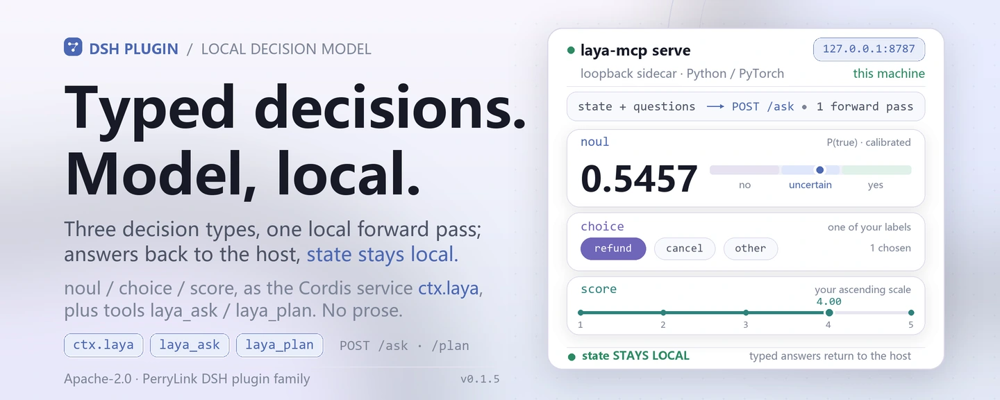
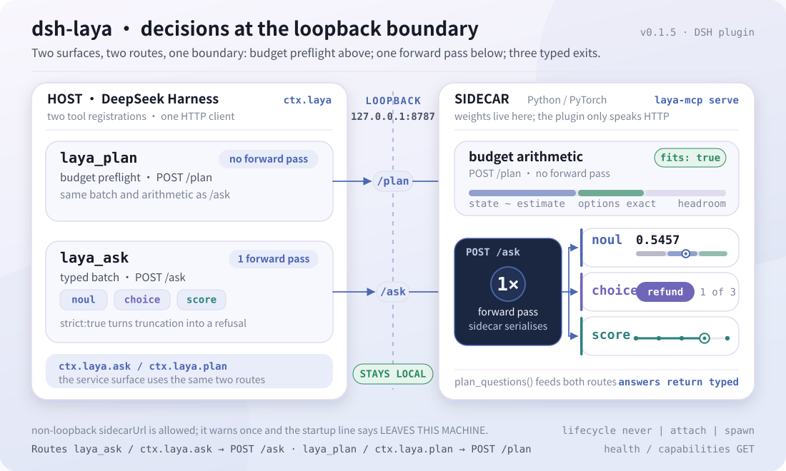
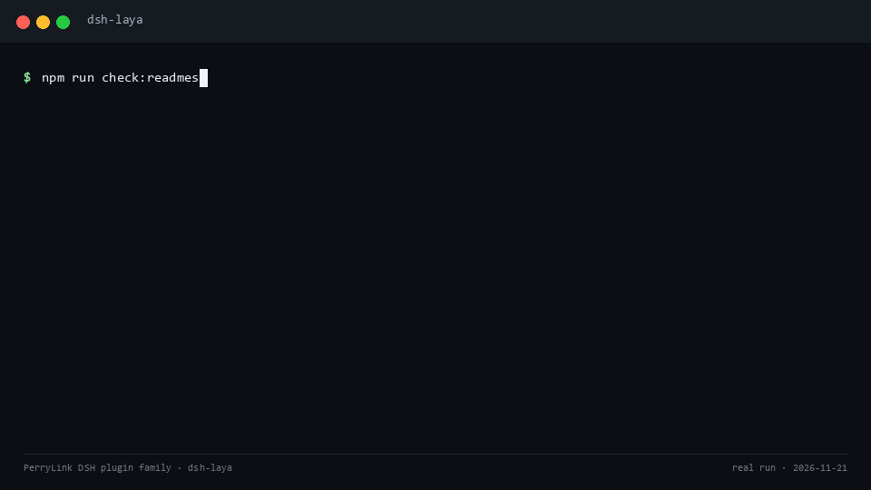

<div align="center">

<picture>
  <source media="(prefers-color-scheme: dark)" srcset="docs/assets/dsh-laya-hero-en-dark.webp">
  
</picture>

# dsh-laya

**Turn yes/no, which-one, and how-much into one local forward pass — probabilities come back to the host, and the state never leaves this machine.**

Laya's typed decisions (`noul`, `choice`, `score`) arrive in DeepSeek Harness as a first-class Cordis service, `ctx.laya`, plus two model-visible tools, `laya_ask` and `laya_plan`: it writes no prose, only labels, calibrated probabilities, and scale positions.

[Install](#three-step-setup) · [Configuration](#configuration) · [FAQ](#faq) · [简体中文](README.md) · [English](README.en.md) · [Español](README.es.md) · [Português](README.pt.md) · [हिन्दी](README.hi.md)

[](LICENSE)
[](#compatibility)
[](https://www.npmjs.com/package/dsh-laya)
[](https://github.com/PerryLink/dsh-laya/actions/workflows/ci.yml)
[](#compatibility)

[](https://github.com/PerryLink/dsh-laya/stargazers)
[](https://www.npmjs.com/package/dsh-laya)
[](https://dshfind.com/plugins/PerryLink/dsh-laya?ref=badge)

```sh
dsh plugin --profile <profile> add dsh-laya
```

</div>

<sub>Community plugin, not affiliated with DeepSeek. Canonical repository: <https://github.com/PerryLink/dsh-laya>.</sub>

## What it is

Laya is a model that answers typed questions only: `noul` returns the probability of true, `choice` picks one of the labels you name, and `score` places the state on an ordered scale you declare. `dsh-laya` holds no weights — Laya is PyTorch, so the weights live in the Python sidecar you start with `laya-mcp serve`, and this plugin is only its loopback HTTP client.

It contributes two things to the harness: the service `ctx.laya` (`ask`, `plan`, `health`, `capabilities`, `sidecarUrl`, `loopback`), and two model-visible tools, `laya_ask` and `laya_plan`. Host code and other plugins can therefore ask for a judgment without a model round-trip, and the model can check whether a question batch fits before spending a forward pass.

The default endpoint is `http://127.0.0.1:8787`: the state does not leave this machine. Pointing `sidecarUrl` elsewhere is allowed, but the startup line names the destination — that is the moment the privacy story changes.

<div align="center">

<picture>
  <source media="(prefers-color-scheme: dark)" srcset="docs/assets/dsh-laya-flow-v5-dark.svg">
  
</picture>

</div>

## Three-step setup




*Animated replay of a real run in this repository (2026-11-21).*

Two pieces, because Laya is PyTorch and cannot live inside a Node plugin.

1. **Start the sidecar** (the half that actually holds the model):

   ```sh
   pip install "laya-mcp[mcp]"
   laya-mcp serve                      # loads once, listens on 127.0.0.1:8787
   ```

2. **Install this plugin**:

   ```sh
   dsh plugin --profile <profile> add dsh-laya
   ```

   Then confirm the row is `active`, not `failed`.

3. **Check the sidecar is up, then read the startup line**:

   ```sh
   curl -s http://127.0.0.1:8787/health
   ```

   ```text
   [dsh-laya] sidecar=http://127.0.0.1:8787 (this machine only) · lifecycle=never
   [dsh-laya] ready · tools: laya_ask laya_plan · sidecar=http://127.0.0.1:8787 · state STAYS LOCAL
   ```

   Whether the startup line ends in `STAYS LOCAL` or `LEAVES THIS MACHINE` is the answer to where the state goes.

   *Observed from `index.js:461-464; index.js:609-612`*

**Uninstall**: `dsh plugin --profile <profile> remove dsh-laya` (or delete the row from the profile patch).

> This plugin ships no model and runs no inference of its own: `laya_plan` triggers no forward pass, but it is still an HTTP call to the sidecar. With no sidecar both tools fail, as described in the FAQ.

## Core capabilities

`dsh-laya` wires Laya's judgment into the host side instead of wrapping another prompt:

- **One service, `ctx.laya`** — host code and other plugins can ask directly: `const laya = ctx.get('laya'); const result = await laya.ask({ state, questions })`.
- **Two tools** — `laya_ask` handles a batch of typed questions; `laya_plan` checks the token budget before you spend a forward pass.
- **Three primitives** — `noul` (yes/no, with a `no` / `uncertain` / `yes` band), `choice` (one label out of the ones you declare), `score` (a position on the ordered scale you declare).
- **Budget preflight** — `POST /plan` shares the same arithmetic as `POST /ask` and runs no forward pass; option figures are exact, the state figure is a character estimate marked `"exact": false`.
- **Failures with meaning** — unreachable is `sidecar_unreachable`, too slow is `sidecar_timeout`; a rejection the sidecar computed itself (such as `state_truncated`) is passed through with its own `code` and `hint`.
- **Sidecar lifecycle** — `never` / `attach` / `spawn`; a sidecar already answering is attached to and never touched, and a sidecar this plugin started is stopped on unmount.
- **Concurrency-safe** — both tools declare `isConcurrencySafe`, so independent judgments join the host's parallel pool; the sidecar serialises forward passes itself.

```text
state + questions ──laya_ask──▶ POST /ask  ──▶ laya-mcp serve ──▶ noul / choice / score
state + questions ──laya_plan─▶ POST /plan ──▶ budget arithmetic (no forward pass)
```

### Service and tool surface

| Surface | Runs a forward pass | Notes |
|---|---|---|
| `ctx.laya.ask` | yes | Passthrough to `POST /ask`; returns the sidecar's raw payload |
| `ctx.laya.plan` | no | Passthrough to `POST /plan`, same budget arithmetic as `ask` |
| `ctx.laya.health` | no | `GET /health`: checkpoint list, call count, `degraded` |
| `ctx.laya.capabilities` | no | `GET /capabilities` |
| `ctx.laya.sidecarUrl` / `loopback` | no | The current endpoint, and whether state stays on this machine — a fact, not a policy |
| `laya_ask` | yes | A batch of typed questions; `strict: true` turns truncation into a refusal |
| `laya_plan` | no | Budget preflight; reports what fits without producing an answer |

### Example call

The minimal question shape from `SKILL.md` — this is what goes in `laya_ask`'s `questions.<id>`, with the evidence in `state`:

```json
{
  "type": "noul",
  "instructions": "Does the user threaten to cancel?",
  "boundary": {
    "true": "an explicit threat to cancel or not renew",
    "false": "no threat, however annoyed the tone"
  }
}
```

A `choice` takes `criteria` as a label-to-description map; a `score` takes `criteria` as an ascending array of level descriptions, at least two, each described. A `noul` may omit `criteria`, and when given it must be `{"true": …, "false": …}`. The tool card renders a `noul` as `<id>=<probability> (<band>)`, a `choice` as the label, and a `score` as the scale value.

*Observed from `index.js:256-273; index.js:341-365`*

## Measured data

| Measurement | Value |
|---|---|
| Sidecar contract, end to end (RTX 5060) | 9.8 s load; 411 ms for three questions on CUDA |
| `noul` without `boundary` | 40/40 items answered false (English and Chinese alike) — exactly chance |
| `noul` with `boundary` | The same 40 items: 1.000 and 0.975 |
| One real calibration example | 0.5457 with the band `uncertain` |

These are measurements that already happened in the integration layer and the skill docs, not a benchmark this repository re-ran. There is no `benchmark/RESULTS.md` here, so no measured-data chart is drawn; upstream's own accuracy figures are in Known limitations.

## Configuration

Every tunable is a `Config` field, documented key by key in `cordis.patch.yml`. An id-targeted override replaces the whole row — restate every key you need.

Most-used keys:

| Key | Default | Meaning |
|---|---|---|
| `sidecarUrl` | `'http://127.0.0.1:8787'` | Sidecar address. Loopback = state stays on this machine; pointing it elsewhere changes the privacy story and warns once at startup, naming the destination |
| `lifecycle` | `never` | What to do when nothing answers at `sidecarUrl`: `never` / `attach` / `spawn` (see below) |
| `spawnCommand` | `null` | The command to run for `lifecycle: spawn`, argv-style. No default — this plugin does not guess at an interpreter |
| `requestTimeoutMs` | `120000` | Per-request timeout. Warm inference is 30–500 ms, but the first call after a cold start can pay a model load |
| `logLevel` | `info` | `silent` / `warn` / `info` / `debug`. `debug` records the spawned sidecar's stdout / stderr line by line |

`lifecycle` decides what happens when nothing is answering at `sidecarUrl`:

| | |
|---|---|
| `never` | Start nothing; assume something else manages the sidecar. The default. |
| `attach` | Also check `/health` once at load and log what it found — useful when the harness and the sidecar race at startup. |
| `spawn` | Also run `spawnCommand` if nothing answers, then wait for it to come up. |

`spawn` exists because the alternative was worse. The plugin still installs nothing and downloads nothing — a tool that ran `pip install` and then fetched a 650 MB checkpoint behind your back would be hostile, and that has not changed. But *launching a sidecar you already installed* is a different act; without it every session began by starting a Python process in a terminal by hand, and began failing again every time that process went away.

Two rules make it safe to leave on:

* A sidecar that is already answering is **attached to and never touched**, so two harness sessions cannot put two models on one port.
* A sidecar this plugin started is **stopped when the plugin unmounts**; one it did not start is left exactly as it was found.

The split also buys the warm model: Laya's cold build costs seconds to tens of seconds, and its default lazy router rebuilds a checkpoint on every language switch. `laya-mcp serve` pays that once.

On Windows a console script is a `.cmd` shim, which this resolves through `cmd.exe /c`; pointing at `python -m laya_mcp` sidesteps that entirely.

<details>
<summary>Full configuration table (6 keys)</summary>

| Key | Default | Meaning |
|---|---|---|
| `sidecarUrl` | `'http://127.0.0.1:8787'` | Sidecar address; must be an http(s) URL. Loopback by default — the sidecar has no authentication and should not be exposed |
| `requestTimeoutMs` | `120000` | Per-request timeout in milliseconds. The first call after a cold start can pay a model load, so this is deliberately generous |
| `lifecycle` | `never` | `never` assumes something else manages the sidecar; `attach` checks `/health` once at load and logs it; `spawn` runs `spawnCommand` when nothing answers |
| `spawnCommand` | `null` | The command for `spawn`, argv-style, e.g. `['laya-mcp', 'serve']` or `['python', '-m', 'laya_mcp', 'serve', '--model', 'english']`. Validated at load, so a typo fails at startup naming the field |
| `spawnTimeoutMs` | `120000` | How long to wait for a spawned sidecar to answer `/health`, in milliseconds. A timeout is reported, not fatal: the tools work as soon as the sidecar does |
| `logLevel` | `info` | `silent` / `warn` / `info` / `debug` |

Invalid values fail loudly at load: `sidecarUrl` must be non-empty and http(s); both timeouts must be positive; `lifecycle` must be one of the three; `spawnCommand` must be a non-empty array of non-empty strings; `logLevel` must be one of the four.

</details>

Example override in your profile patch:

```yaml
- insert:
    - id: laya
      name: 'dsh-laya'
      config:
        sidecarUrl: 'http://127.0.0.1:8787'
        requestTimeoutMs: 120000
        lifecycle: never      # 'attach' logs a reachability check,
                              # 'spawn' starts the sidecar itself
        spawnCommand: null    # required by 'spawn', e.g. ['laya-mcp', 'serve']
        spawnTimeoutMs: 120000
        logLevel: info
```

## FAQ

<details>
<summary>Where does the state actually go? Can it reach the cloud?</summary>

Only to `sidecarUrl`. The default is `127.0.0.1:8787`, this machine, and the startup line then says `state STAYS LOCAL`. Pointing `sidecarUrl` at a non-loopback host is allowed, but it warns once at startup and names the destination — that is the moment the privacy story changes. The plugin itself installs nothing, downloads nothing, sends no telemetry, and caches the state nowhere.

</details>

<details>
<summary>What happens when the sidecar is down or dies — silent breakage?</summary>

Nothing is silent. An unreachable sidecar makes the tools return `sidecar_unreachable`, a timeout returns `sidecar_timeout`, and both say to start `laya-mcp serve` first; the tools stay registered and recover as soon as something answers. `lifecycle: attach` checks `/health` once at load and logs the result; `lifecycle: spawn` starts `spawnCommand` when nothing answers, and a startup timeout warns without being fatal; a spawned sidecar that exits logs one visible warning.

</details>

<details>
<summary>Does it fight other plugins over tool names, service keys, or slots?</summary>

No. Tool names are namespaced (`laya_ask`, `laya_plan`), it publishes exactly one service key, `laya`, `inject` waits on `tools` only, and it registers no commands, no client slot, no `webServer` prefix, and mutates no globals. The point-by-point argument is in "Interoperability with other DSH plugins".

</details>

<details>
<summary>Why must I install a Python sidecar separately? Why not bundle it?</summary>

Because Laya is PyTorch and the weights are a several-hundred-megabyte checkpoint that cannot live inside a Node plugin. A plugin that quietly ran `pip install` and downloaded weights would be hostile however convenient, so this one is a client only; even `lifecycle: spawn` launches a command you **already installed**, and `spawnCommand` has no default.

</details>

<details>
<summary>How should I read the output? What is dangerous about `confidence` and truncation?</summary>

`confidence` is not accuracy but a concentration statistic over the options: it is low even when the top option is right, and high on a confident wrong answer. A `noul` therefore also carries a `no` / `uncertain` / `yes` band — 0.5457 with `uncertain` is a real example from this stack. Truncation is the opposite problem: an oversized state is cut from the end without warning, and the answer is about the surviving prefix; read `truncated`, `budget_summary`, and `warnings`, or call `laya_plan` first.

</details>

## Security boundaries

- **No install, no download.** This plugin contains no weights and runs no `pip install`; `lifecycle: spawn` only launches a command the operator names explicitly, and `spawnCommand` has no default, so it never guesses at an interpreter.
- **Visible destination.** State is sent only to `sidecarUrl`; a non-loopback address warns once at startup and names the destination, and the startup line always states `STAYS LOCAL` or `LEAVES THIS MACHINE`.
- **The sidecar has no authentication.** It binds `127.0.0.1:8787` by default; do not expose it to the internet, and do not point `sidecarUrl` at a shared host.
- **No preemption.** A sidecar already answering is attached to and never touched, so two harness sessions cannot put two models on one port; this plugin stops only the sidecar it started and leaves every other process exactly as it was found.
- **Misconfiguration fails at load.** An invalid `sidecarUrl`, a non-positive timeout, an unknown `lifecycle`, a malformed `spawnCommand`, or an unknown `logLevel` all fail loudly at startup naming the field, instead of waiting for the first tool call.
- **Registrations are effects.** The service, the tools, and the sidecar lifecycle all hang off Cordis effects — stop or hot-reload removes them, and a sidecar this plugin started stops with them.

## Permissions and data

- **Permissions**: `package.json`'s `dsh.capabilities` declares `network:egress` only. The plugin writes no files, keeps no cache, and stores no credentials; its only filesystem call resolves `spawnCommand` on `PATH` (`existsSync` in `sidecar.js`).
- **Data**: the request body (`state` + `questions`) is forwarded verbatim to `sidecarUrl`, loopback by default; the plugin writes nothing to disk, caches nothing, and has no telemetry.
- **Logs**: only the startup line, health summaries, and errors; `logLevel` controls the verbosity, and `debug` records the spawned sidecar's stdout / stderr line by line so a Python traceback stays visible.
- **Session**: the tool's `answers`, `truncated`, `budget_summary`, and `warnings` are exactly what the model sees; the plugin appends nothing to the session log.

## Known limitations

- **Upstream accuracy is the ceiling.** Repeated from upstream's own measurements, because an integration that implies otherwise is lying to you: the base checkpoints are **near chance zero-shot** on typed decisions (0.362 for English against a 0.461 majority-class baseline); `score` is the weakest primitive (35% vs 70% for Jev in independent measurement); raw calibration error is 0.466 before temperature fitting; and accuracy falls off above roughly 20 options. Calibration makes a probability honest. It cannot make a model right.
- **Silent truncation.** An oversized state is cut from the **end**, the answer is then about the surviving prefix, and Laya's own output does not admit it. The response reports it under `truncated`, and `laya_plan` tells you before you ask; pass `strict: true` to refuse instead — verified against the live sidecar, which returns HTTP 400 with `state_truncated` and a hint naming `max_len`.
- **`confidence` is not accuracy.** It is a concentration statistic: low whenever probability is spread across options even when the top option is right, and high on a confident wrong answer. A `noul` also carries a `no` / `uncertain` / `yes` band, because a calibrated probability is not a decision — a real measured example from this stack returned 0.5457 with the band `uncertain`.
- **A silent CPU demotion is reported.** If Laya falls back to CPU after a device error it never returns to the accelerator, and nothing in its own output admits it. The health surface carries `degraded`, and the tool card appends `CPU (degraded)`.
- **Limited language coverage.** The detector covers en / fr / de / es / pt / it / nl only; anything else in Latin script is silently routed to the English checkpoint, which then answers confidently and wrongly. Pass `lang` (for example `"de"`) to `laya_ask` to pin the language.
- **The sidecar is yours to provide.** This plugin ships no model: with no `laya-mcp serve` running, the tools return `sidecar_unreachable` (or `sidecar_timeout` when it is too slow).
- **Status (work in progress).** The plugin mounts and activates in the harness, and the sidecar contract it speaks has been verified end to end on an RTX 5060 (9.8 s load, 411 ms for three questions on CUDA); it has not yet been exercised through a live model turn in CI.

## Interoperability with other DSH plugins

Verified against the registration surface in `index.js` and `cordis.patch.yml`. This plugin does not interfere with other plugins:

- **One consumed service.** `inject = ['tools']`, and only that: Cordis makes the plugin wait for every key in `inject`, so listing a service most profiles do not compose (such as `skills`) would leave the plugin `pending` forever.
- **Namespaced tools.** `laya_ask` and `laya_plan`; no bare name owned by a built-in tool or another plugin is registered.
- **One published service key.** `laya`; it provides nothing else, so it cannot collide on a service key.
- **No commands, slots, or HTTP routes.** It registers no DSH command, no client slot key, and no `webServer` prefix.
- **No patch-layer collision.** The bundle patch only `insert`s its own row; it never overrides a built-in row's `config`.
- **No global mutation.** It does not patch prototypes, rewrite `process.env`, or replace the global fetch dispatcher.
- **No shared event listeners.** It never calls `ctx.on(...)`, so it does not compete on ordering-sensitive events and cannot short-circuit a chain.
- **Concurrency declaration.** Both tools declare `isConcurrencySafe`, so independent judgments join the host's parallel pool; the sidecar serialises forward passes itself.

## Compatibility

| Surface | Status |
|---|---|
| Harness | Verified against `dsh-v0.1.7-alpha.1` (the host release this build targets); requires `>=0.1.7-alpha.1 <0.3.0` (`engines.dsh` in `package.json`) |
| Node | `^22.19.0 \|\| >=24.0.0` (CI runs Node 22 and 24) |
| Platforms | Anywhere DSH runs, plus a local Python sidecar (PyTorch); verified on an RTX 5060 with CUDA, and a CPU fallback is reported as `degraded` |
| Model | A Laya checkpoint (`noul` / `choice` / `score`); not a generative model, and it cannot write text, code, or commands |
| CI | `ubuntu-latest` and `windows-latest` × Node 22 / 24: `npm test` + `npm run check:readmes` |

## Ecosystem & quality

- [npm package](https://www.npmjs.com/package/dsh-laya) (currently 0.1.5)
- [dshfind plugin page](https://dshfind.com/plugins/PerryLink/dsh-laya) (installs and ranking; same source as the badge)
- [Laya upstream](https://github.com/NandhaKishorM/laya) (the model weights and the `laya-mcp` sidecar; Apache-2.0)
- **CI**: [`.github/workflows/ci.yml`](.github/workflows/ci.yml) runs `npm test` and `npm run check:readmes` on two OSes × two Node versions, with deliberately no `npm install` step — the tests cover only the pure surface (`plan.js`, `sidecar.js`) and need no mounted harness.

## Development

```sh
npm test                 # node --test (the pure surface of plan.js / sidecar.js)
npm run check:readmes    # five-language README sync: sections / install command / config keys
npm pack                 # the published tarball
```

There is no build step: pure ESM, `index.js`, `plan.js`, and `sidecar.js` are the shipped artifacts; `SKILL.md` and `cordis.patch.yml` ship too (see `files` in `package.json`).

The README images are generated programmatically by [`scripts/gen-readme-assets.py`](scripts/gen-readme-assets.py) (Python + Pillow, including a CJK font probe) and are safe to re-run: `python scripts/gen-readme-assets.py`.

Layout:

```text
index.js            Cordis plugin: Config validation, the ctx.laya service, laya_ask / laya_plan
plan.js             the pure budget-preflight surface (output schema, shaping, summary)
sidecar.js          spawn resolution and lifecycle (PATH lookup, cmd.exe /c, process stop)
SKILL.md            the agent-facing Laya instructions (shipped in the package)
cordis.patch.yml    the bundle row; every Config key documented inline
test/               node --test (plan / sidecar)
scripts/            mechanical gates: check-readme-sync.mjs, gen-readme-assets.py
```

Topics: `dsh-plugin`, `deepseek-harness`, `cordis`, `laya`, `decision-model`, `system-one`, `typed-decisions`

## Family & thanks

This project is part of the DeepSeek Harness plugin family from [PerryLink](https://github.com/PerryLink) (all Apache-2.0). If it is useful, **a star helps the next person find it** — nothing is gated behind it.

- [@PerryLink](https://github.com/PerryLink) — creator and maintainer: the `ctx.laya` service, the `laya_ask` / `laya_plan` tools, the sidecar lifecycle (`never` / `attach` / `spawn`), and the five-language docs.
- [Convai Innovations / Laya](https://github.com/NandhaKishorM/laya) — authors of the upstream model and the `laya-mcp` sidecar; this plugin is an independent integration, not an official component of that project.

<details>
<summary>Expand all plugins</summary>

| Plugin | Status |
|---|---|
| **[dsh-auto-review](https://github.com/PerryLink/dsh-auto-review)** |  |
| **[dsh-autotier](https://github.com/PerryLink/dsh-autotier)** | 🧊 FROZEN — see the repo README |
| **[dsh-background-agents](https://github.com/PerryLink/dsh-background-agents)** | 🚫 RETIRED (repo archived) |
| **[dsh-budget](https://github.com/PerryLink/dsh-budget)** | 🧊 FROZEN — see the repo README |
| **[dsh-catalog](https://github.com/PerryLink/dsh-catalog)** |  |
| **[dsh-cert-mcp](https://github.com/PerryLink/dsh-cert-mcp)** | 🧊 FROZEN — see the repo README |
| **[dsh-checkpoint-rewind](https://github.com/PerryLink/dsh-checkpoint-rewind)** |  |
| **[dsh-claude-move](https://github.com/PerryLink/dsh-claude-move)** | 🧊 FROZEN — see the repo README |
| **[dsh-click](https://github.com/PerryLink/dsh-click)** |  |
| **[dsh-composer-history](https://github.com/PerryLink/dsh-composer-history)** |  |
| **[dsh-data-quality](https://github.com/PerryLink/dsh-data-quality)** | 🧊 FROZEN — see the repo README |
| **[dsh-defend](https://github.com/PerryLink/dsh-defend)** | 🧊 FROZEN — see the repo README |
| **[dsh-doublecheck](https://github.com/PerryLink/dsh-doublecheck)** |  |
| **[dsh-draw](https://github.com/PerryLink/dsh-draw)** | 🧊 FROZEN — see the repo README |
| **[dsh-fast](https://github.com/PerryLink/dsh-fast)** |  |
| **[dsh-fund-research](https://github.com/PerryLink/dsh-fund-research)** |  |
| **[dsh-github](https://github.com/PerryLink/dsh-github)** |  |
| **[dsh-industry-research](https://github.com/PerryLink/dsh-industry-research)** |  |
| **[dsh-laya](https://github.com/PerryLink/dsh-laya)** |  |
| **[dsh-library](https://github.com/PerryLink/dsh-library)** |  |
| **[dsh-local-ai](https://github.com/PerryLink/dsh-local-ai)** |  |
| **[dsh-lsp-actions](https://github.com/PerryLink/dsh-lsp-actions)** |  |
| **[dsh-mask](https://github.com/PerryLink/dsh-mask)** |  |
| **[dsh-mcp-panel](https://github.com/PerryLink/dsh-mcp-panel)** |  |
| **[dsh-memento](https://github.com/PerryLink/dsh-memento)** | 🧊 FROZEN — see the repo README |
| **[dsh-observe](https://github.com/PerryLink/dsh-observe)** |  |
| **[dsh-output-styles](https://github.com/PerryLink/dsh-output-styles)** |  |
| **[dsh-permission-rules](https://github.com/PerryLink/dsh-permission-rules)** |  |
| **[dsh-plugin-certification](https://github.com/PerryLink/dsh-plugin-certification)** | 🚫 RETIRED (repo archived) |
| **[dsh-plugin-doctor](https://github.com/PerryLink/dsh-plugin-doctor)** | 🚫 RETIRED (repo archived) |
| **[dsh-plugin-guide](https://github.com/PerryLink/dsh-plugin-guide)** |  |
| **[dsh-plugin-kit](https://github.com/PerryLink/dsh-plugin-kit)** | 🚫 RETIRED (repo archived) |
| **[dsh-plugin-upgrade](https://github.com/PerryLink/dsh-plugin-upgrade)** | 🚫 RETIRED (repo archived) |
| **[dsh-plugin-upgrade-015](https://github.com/PerryLink/dsh-plugin-upgrade-015)** | 🚫 RETIRED (repo archived) |
| **[dsh-reach](https://github.com/PerryLink/dsh-reach)** | 🧊 FROZEN — see the repo README |
| **[dsh-research-report](https://github.com/PerryLink/dsh-research-report)** |  |
| **[dsh-score](https://github.com/PerryLink/dsh-score)** | 🧊 FROZEN — see the repo README |
| **[dsh-session-pin](https://github.com/PerryLink/dsh-session-pin)** | 🚫 RETIRED (repo archived) |
| **[dsh-session-sync](https://github.com/PerryLink/dsh-session-sync)** |  |
| **[dsh-skill-pack-security](https://github.com/PerryLink/dsh-skill-pack-security)** |  |
| **[dsh-talk](https://github.com/PerryLink/dsh-talk)** |  |
| **[dsh-team-rooms](https://github.com/PerryLink/dsh-team-rooms)** | 🚫 RETIRED (repo archived) |
| **[dsh-test-drive](https://github.com/PerryLink/dsh-test-drive)** |  |
| **[dsh-ticktick](https://github.com/PerryLink/dsh-ticktick)** | 🚫 RETIRED (repo archived) |
| **[dsh-translate](https://github.com/PerryLink/dsh-translate)** |  |

</details>

## License

[LICENSE](LICENSE) (Apache License 2.0) © 2026 dsh-laya contributors. Laya is Apache-2.0 by Convai Innovations; this is an independent integration and is not affiliated with or endorsed by that project.

<p align="center"><sub>Apache-2.0 · Community plugin, not affiliated with DeepSeek.</sub></p>
