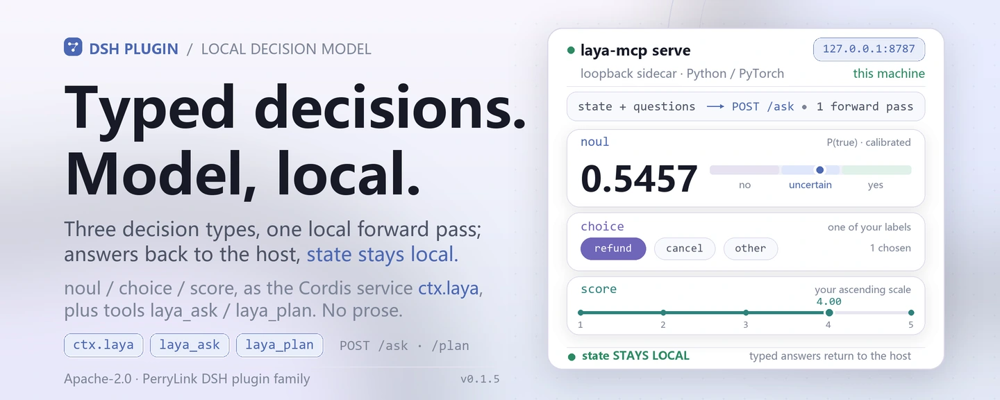
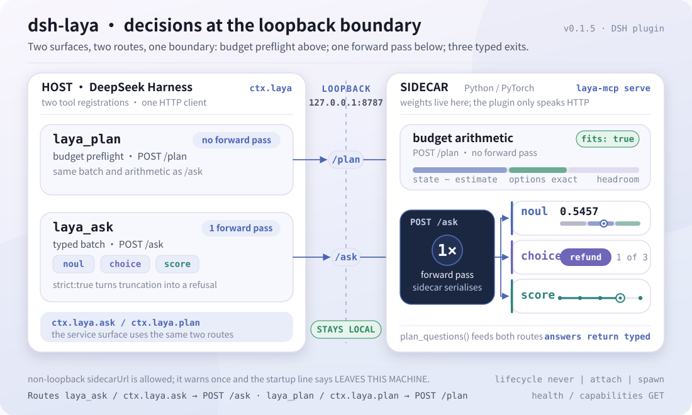
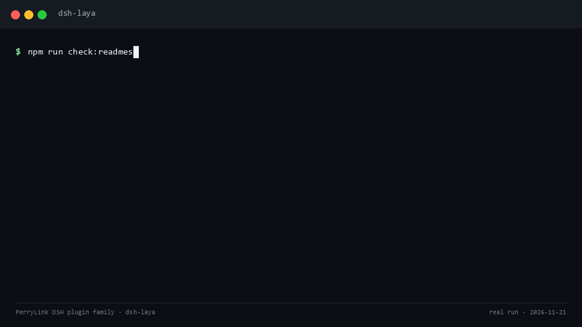

<div align="center">

<picture>
  <source media="(prefers-color-scheme: dark)" srcset="docs/assets/dsh-laya-hero-en-dark.webp">
  
</picture>

# dsh-laya

**Convierte sí/no, cuál y cuánto en un único pase local hacia delante: las probabilidades vuelven al host y el estado no sale de esta máquina.**

Las decisiones tipadas de Laya (`noul`, `choice`, `score`) llegan a DeepSeek Harness como un servicio Cordis de primera clase, `ctx.laya`, y dos herramientas visibles para el modelo, `laya_ask` y `laya_plan`: no escribe prosa, solo etiquetas, probabilidades calibradas y posiciones en una escala.

Última verificación: DeepSeek Harness `dsh-v0.2.3-alpha.1` (2026-11-22).

[Instalar](#instalación-en-tres-pasos) · [Configuración](#configuración) · [FAQ](#faq) · [简体中文](README.md) · [English](README.en.md) · [Español](README.es.md) · [Português](README.pt.md) · [हिन्दी](README.hi.md)

[](LICENSE)
[](#compatibilidad)
[](https://www.npmjs.com/package/dsh-laya)
[](https://github.com/PerryLink/dsh-laya/actions/workflows/ci.yml)
[](#compatibilidad)

[](https://github.com/PerryLink/dsh-laya/stargazers)
[](https://www.npmjs.com/package/dsh-laya)
[](https://dshfind.com/plugins/PerryLink/dsh-laya?ref=badge)

```sh
dsh plugin --profile <profile> add dsh-laya
```

</div>

<sub>Plugin de la comunidad, no afiliado a DeepSeek. Repositorio canónico: <https://github.com/PerryLink/dsh-laya>.</sub>

## Qué es

Laya es un modelo que solo responde preguntas tipadas: `noul` devuelve la probabilidad de verdadero, `choice` elige una de las etiquetas que declares y `score` sitúa el estado en una escala ordenada que tú defines. `dsh-laya` no contiene pesos: Laya es PyTorch, así que los pesos viven en el sidecar de Python que arrancas con `laya-mcp serve`, y este plugin es solo su cliente HTTP por loopback.

Aporta dos cosas al harness: el servicio `ctx.laya` (`ask`, `plan`, `health`, `capabilities`, `sidecarUrl`, `loopback`) y dos herramientas visibles para el modelo, `laya_ask` y `laya_plan`. Así el código del host y otros plugins pueden pedir un juicio sin una ida y vuelta al modelo, y el modelo puede comprobar si un lote de preguntas cabe antes de gastar un pase hacia delante.

El endpoint por defecto es `http://127.0.0.1:8787`: el estado no sale de esta máquina. Apuntar `sidecarUrl` a otro sitio está permitido, pero la línea de arranque nombra el destino: ese es el momento en que cambia la historia de privacidad.

<div align="center">

<picture>
  <source media="(prefers-color-scheme: dark)" srcset="docs/assets/dsh-laya-flow-v5-dark.svg">
  
</picture>



*Repetición animada de una ejecución real de este repositorio (2026-11-21).*

</div>

## Instalación en tres pasos

Dos piezas, porque Laya es PyTorch y no puede vivir dentro de un plugin de Node.

1. **Arranca el sidecar** (la mitad que de verdad contiene el modelo):

   ```sh
   pip install "laya-mcp[mcp]"
   laya-mcp serve                      # carga una vez, escucha en 127.0.0.1:8787
   ```

2. **Instala este plugin**:

   ```sh
   dsh plugin --profile <profile> add dsh-laya
   ```

   Después confirma que la fila está `active` y no `failed`.

3. **Comprueba que el sidecar responde y lee la línea de arranque**:

   ```sh
   curl -s http://127.0.0.1:8787/health
   ```

   ```text
   [dsh-laya] sidecar=http://127.0.0.1:8787 (this machine only) · lifecycle=never
   [dsh-laya] ready · tools: laya_ask laya_plan · sidecar=http://127.0.0.1:8787 · state STAYS LOCAL
   ```

   Que la línea de arranque termine en `STAYS LOCAL` o en `LEAVES THIS MACHINE` es la respuesta a dónde va el estado.

   *Observed from `index.js:461-464; index.js:609-612`*

**Desinstalar**: `dsh plugin --profile <profile> remove dsh-laya` (o borra la fila del patch del perfil).

> Este plugin no incluye modelo ni ejecuta inferencia propia: `laya_plan` no dispara ningún pase hacia delante, pero sigue siendo una llamada HTTP al sidecar. Sin sidecar fallan las dos herramientas, como se explica en las preguntas frecuentes.

## Capacidades clave

`dsh-laya` conecta el juicio de Laya al lado del host en lugar de envolver otro prompt:

- **Un servicio, `ctx.laya`** — el código del host y otros plugins pueden preguntar directamente: `const laya = ctx.get('laya'); const result = await laya.ask({ state, questions })`.
- **Dos herramientas** — `laya_ask` gestiona un lote de preguntas tipadas; `laya_plan` revisa el presupuesto de tokens antes de gastar un pase hacia delante.
- **Tres primitivas** — `noul` (sí/no, con banda `no` / `uncertain` / `yes`), `choice` (una etiqueta entre las que declares) y `score` (una posición en la escala ordenada que declares).
- **Preflight de presupuesto** — `POST /plan` comparte la misma aritmética que `POST /ask` y no ejecuta pase alguno; las cifras de opciones son exactas y la del estado es una estimación por caracteres marcada `"exact": false`.
- **Fallos con significado** — inalcanzable es `sidecar_unreachable`, demasiado lento es `sidecar_timeout`; un rechazo calculado por el propio sidecar (por ejemplo `state_truncated`) se propaga con su `code` y su `hint`.
- **Ciclo de vida del sidecar** — `never` / `attach` / `spawn`; un sidecar que ya responde se engancha y nunca se toca, y el que arranca este plugin se detiene al desmontarlo.
- **Seguro para concurrencia** — ambas herramientas declaran `isConcurrencySafe`, así que los juicios independientes entran en el pool paralelo del host; el sidecar serializa los pases por su cuenta.

```text
state + questions ──laya_ask──▶ POST /ask  ──▶ laya-mcp serve ──▶ noul / choice / score
state + questions ──laya_plan─▶ POST /plan ──▶ aritmética de presupuesto (sin pase)
```

### Superficie de servicio y herramientas

| Superficie | Ejecuta un pase | Notas |
|---|---|---|
| `ctx.laya.ask` | sí | Passthrough a `POST /ask`; devuelve la carga cruda del sidecar |
| `ctx.laya.plan` | no | Passthrough a `POST /plan`, la misma aritmética que `ask` |
| `ctx.laya.health` | no | `GET /health`: checkpoints, número de llamadas, `degraded` |
| `ctx.laya.capabilities` | no | `GET /capabilities` |
| `ctx.laya.sidecarUrl` / `loopback` | no | El endpoint actual y si el estado se queda en esta máquina: un hecho, no una política |
| `laya_ask` | sí | Un lote de preguntas tipadas; `strict: true` convierte el truncado en rechazo |
| `laya_plan` | no | Preflight del presupuesto; informa de qué cabe sin producir respuesta |

### Ejemplo de llamada

La forma mínima de pregunta de `SKILL.md`: esto es lo que va en `questions.<id>` de `laya_ask`, con la evidencia en `state`:

```json
{
  "type": "noul",
  "instructions": "Does the user threaten to cancel?",
  "boundary": {
    "true": "an explicit threat to cancel or not renew",
    "false": "no threat, however annoyed the tone"
  }
}
```

Un `choice` recibe `criteria` como mapa de etiqueta a descripción; un `score` recibe `criteria` como array ascendente de descripciones de nivel, al menos dos y todas descritas. Un `noul` puede omitir `criteria` y, si la da, debe ser `{"true": …, "false": …}`. La tarjeta de la herramienta muestra un `noul` como `<id>=<probabilidad> (<banda>)`, un `choice` como la etiqueta y un `score` como el valor de la escala.

*Observed from `index.js:256-273; index.js:341-365`*

## Datos medidos

| Medición | Valor |
|---|---|
| Contrato del sidecar, de extremo a extremo (RTX 5060) | 9,8 s de carga; 411 ms para tres preguntas en CUDA |
| `noul` sin `boundary` | 40/40 ítems respondidos como falso (igual en inglés y en chino): exactamente azar |
| `noul` con `boundary` | Los mismos 40 ítems: 1,000 y 0,975 |
| Un ejemplo real de calibración | 0,5457 con la banda `uncertain` |

Son mediciones que ya ocurrieron en la capa de integración y en los documentos de la skill, no un benchmark que este repositorio haya vuelto a ejecutar. Aquí no hay `benchmark/RESULTS.md`, así que no se dibuja gráfico de datos medidos; las cifras de precisión del upstream están en Limitaciones conocidas.

## Configuración

Todo lo ajustable son campos de `Config`, documentados clave por clave en `cordis.patch.yml`. Una sobrescritura dirigida por id reemplaza la fila entera: repite todas las claves que necesites.

Claves más usadas:

| Clave | Por defecto | Significado |
|---|---|---|
| `sidecarUrl` | `'http://127.0.0.1:8787'` | Dirección del sidecar. Loopback = el estado no sale de esta máquina; apuntarla a otro sitio cambia la historia de privacidad y avisa una vez al arrancar, nombrando el destino |
| `lifecycle` | `never` | Qué hacer cuando nada responde en `sidecarUrl`: `never` / `attach` / `spawn` (ver abajo) |
| `spawnCommand` | `null` | El comando a ejecutar con `lifecycle: spawn`, estilo argv. Sin valor por defecto: este plugin no adivina un intérprete |
| `requestTimeoutMs` | `120000` | Timeout por petición. La inferencia en caliente tarda 30–500 ms, pero la primera llamada tras un arranque en frío puede pagar la carga del modelo |
| `logLevel` | `info` | `silent` / `warn` / `info` / `debug`. `debug` registra línea a línea el stdout / stderr del sidecar lanzado |

`lifecycle` decide qué ocurre cuando nada responde en `sidecarUrl`:

| | |
|---|---|
| `never` | No arranca nada; asume que otra cosa gestiona el sidecar. El valor por defecto. |
| `attach` | Además consulta `/health` una vez al cargar y registra lo que encontró: útil cuando el harness y el sidecar compiten al arrancar. |
| `spawn` | Además ejecuta `spawnCommand` si nada responde y espera a que levante. |

`spawn` existe porque la alternativa era peor. El plugin sigue sin instalar ni descargar nada: una herramienta que ejecutara `pip install` y luego trajera un checkpoint de 650 MB a tus espaldas sería hostil, y eso no ha cambiado. Pero *lanzar un sidecar que ya instalaste* es otro acto; sin él, cada sesión empezaba arrancando un proceso de Python a mano en una terminal, y volvía a fallar cada vez que ese proceso desaparecía.

Dos reglas lo hacen seguro de dejar activado:

* Un sidecar que ya responde **se engancha y nunca se toca**, así que dos sesiones del harness no pueden poner dos modelos en un mismo puerto.
* Un sidecar que arrancó este plugin **se detiene al desmontar el plugin**; el que no arrancó él se queda exactamente como estaba.

La separación también regala el modelo caliente: la construcción en frío de Laya cuesta de segundos a decenas de segundos, y su router perezoso por defecto reconstruye un checkpoint en cada cambio de idioma. `laya-mcp serve` paga eso una sola vez.

En Windows un script de consola es un shim `.cmd`, que aquí se resuelve a través de `cmd.exe /c`; apuntar a `python -m laya_mcp` lo evita por completo.

<details>
<summary>Tabla de configuración completa (6 claves)</summary>

| Clave | Por defecto | Significado |
|---|---|---|
| `sidecarUrl` | `'http://127.0.0.1:8787'` | Dirección del sidecar; debe ser una URL http(s). Loopback por defecto: el sidecar no tiene autenticación y no debería exponerse |
| `requestTimeoutMs` | `120000` | Timeout por petición en milisegundos. La primera llamada tras un arranque en frío puede pagar la carga del modelo, así que es generoso a propósito |
| `lifecycle` | `never` | `never` asume que otra cosa gestiona el sidecar; `attach` consulta `/health` una vez al cargar y lo registra; `spawn` ejecuta `spawnCommand` cuando nada responde |
| `spawnCommand` | `null` | El comando para `spawn`, estilo argv, por ejemplo `['laya-mcp', 'serve']` o `['python', '-m', 'laya_mcp', 'serve', '--model', 'english']`. Se valida al cargar, así que una errata falla al arrancar nombrando el campo |
| `spawnTimeoutMs` | `120000` | Cuánto esperar a que el sidecar lanzado responda `/health`, en milisegundos. Un timeout se informa, no es fatal: las herramientas funcionan en cuanto el sidecar responde |
| `logLevel` | `info` | `silent` / `warn` / `info` / `debug` |

Los valores inválidos fallan en voz alta al cargar: `sidecarUrl` debe ser no vacía y http(s); ambos timeouts deben ser positivos; `lifecycle` debe ser uno de los tres; `spawnCommand` debe ser un array no vacío de cadenas no vacías; `logLevel` debe ser uno de los cuatro.

</details>

Ejemplo de sobrescritura en el patch del perfil:

```yaml
- insert:
    - id: laya
      name: 'dsh-laya'
      config:
        sidecarUrl: 'http://127.0.0.1:8787'
        requestTimeoutMs: 120000
        lifecycle: never      # 'attach' registra una comprobación de alcance,
                              # 'spawn' arranca el sidecar por su cuenta
        spawnCommand: null    # obligatorio con 'spawn', p. ej. ['laya-mcp', 'serve']
        spawnTimeoutMs: 120000
        logLevel: info
```

## FAQ

<details>
<summary>¿Adónde va realmente el estado? ¿Puede llegar a la nube?</summary>

Solo a `sidecarUrl`. Por defecto es `127.0.0.1:8787`, esta máquina, y entonces la línea de arranque dice `state STAYS LOCAL`. Apuntar `sidecarUrl` a un host no loopback está permitido, pero avisa una vez al arrancar y nombra el destino: ese es el momento en que cambia la historia de privacidad. El plugin no instala, no descarga, no envía telemetría y no cachea el estado en ningún sitio.

</details>

<details>
<summary>¿Y si el sidecar está caído o muere? ¿Falla en silencio?</summary>

Nada es silencioso. Un sidecar inalcanzable hace que las herramientas devuelvan `sidecar_unreachable`, un timeout devuelve `sidecar_timeout`, y ambas indican que arranques `laya-mcp serve`; las herramientas siguen registradas y se recuperan en cuanto algo responde. `lifecycle: attach` consulta `/health` una vez al cargar y registra el resultado; `lifecycle: spawn` ejecuta `spawnCommand` cuando nada responde, y un timeout de arranque avisa sin ser fatal; un sidecar lanzado que sale registra un aviso visible.

</details>

<details>
<summary>¿Compite con otros plugins por nombres de herramientas, claves de servicio o slots?</summary>

No. Los nombres de herramientas llevan espacio de nombres (`laya_ask`, `laya_plan`), publica exactamente una clave de servicio, `laya`, `inject` solo espera a `tools`, y no registra comandos, ni slots de cliente, ni prefijos `webServer`, ni muta globales. El argumento punto por punto está en «Interoperabilidad con otros plugins DSH».

</details>

<details>
<summary>¿Por qué hay que instalar un sidecar de Python aparte? ¿No se puede incluir?</summary>

Porque Laya es PyTorch y los pesos son un checkpoint de varios cientos de megabytes que no cabe dentro de un plugin de Node. Un plugin que ejecutara `pip install` a escondidas y descargara pesos sería hostil por muy cómodo que fuera, así que este solo actúa de cliente; incluso `lifecycle: spawn` lanza un comando que **ya instalaste**, y `spawnCommand` no tiene valor por defecto.

</details>

<details>
<summary>¿Cómo se lee la salida? ¿Qué cuidado exigen `confidence` y el truncado?</summary>

`confidence` no es precisión sino una estadística de concentración sobre las opciones: es baja aunque la opción principal sea correcta, y alta en una respuesta segura y equivocada. Por eso un `noul` lleva además una banda `no` / `uncertain` / `yes`: 0,5457 con `uncertain` es un ejemplo real de este stack. El truncado es lo contrario: un estado demasiado grande se corta por el final sin avisar y la respuesta trata del prefijo superviviente; lee `truncated`, `budget_summary` y `warnings`, o llama antes a `laya_plan`.

</details>

## Límites de seguridad

- **Nada se instala ni se descarga.** Este plugin no contiene pesos ni ejecuta `pip install`; `lifecycle: spawn` solo lanza un comando que el operador nombra explícitamente, y `spawnCommand` no tiene valor por defecto, así que nunca adivina un intérprete.
- **Destino visible.** El estado se envía solo a `sidecarUrl`; una dirección no loopback avisa una vez al arrancar y nombra el destino, y la línea de arranque siempre declara `STAYS LOCAL` o `LEAVES THIS MACHINE`.
- **El sidecar no tiene autenticación.** Se enlaza a `127.0.0.1:8787` por defecto; no lo expongas a internet ni apuntes `sidecarUrl` a un host compartido.
- **Sin apropiación.** Un sidecar que ya responde se engancha y nunca se toca, así que dos sesiones del harness no pueden poner dos modelos en un mismo puerto; este plugin solo detiene el sidecar que arrancó y deja cualquier otro proceso exactamente como estaba.
- **La mala configuración falla al cargar.** Un `sidecarUrl` inválido, un timeout no positivo, un `lifecycle` desconocido, un `spawnCommand` mal formado o un `logLevel` desconocido fallan en voz alta al arrancar nombrando el campo, en vez de esperar a la primera llamada.
- **Los registros son efectos.** El servicio, las herramientas y el ciclo de vida del sidecar cuelgan de efectos de Cordis: parar o recargar en caliente los retira, y el sidecar que arrancó este plugin se detiene con ellos.

## Permisos y datos

- **Permisos**: `dsh.capabilities` de `package.json` solo declara `network:egress`. El plugin no escribe archivos, no guarda caché y no almacena credenciales; su única llamada al sistema de archivos resuelve `spawnCommand` en `PATH` (`existsSync` en `sidecar.js`).
- **Datos**: el cuerpo de la petición (`state` + `questions`) se reenvía tal cual a `sidecarUrl`, loopback por defecto; el plugin no escribe en disco, no cachea y no tiene telemetría.
- **Registros**: solo la línea de arranque, resúmenes de salud y errores; `logLevel` controla la verbosidad y `debug` registra línea a línea el stdout / stderr del sidecar para que un traceback de Python siga visible.
- **Sesión**: `answers`, `truncated`, `budget_summary` y `warnings` de la herramienta son exactamente lo que ve el modelo; el plugin no añade nada al registro de sesión.

## Limitaciones conocidas

- **La precisión del upstream es el techo.** Repetido de las mediciones del propio upstream, porque una integración que insinúe otra cosa te está mintiendo: los checkpoints base están **cerca del azar en zero-shot** en decisiones tipadas (0,362 en inglés frente a una línea base de clase mayoritaria de 0,461); `score` es la primitiva más débil (35% frente al 70% de Jev en medición independiente); el error de calibración bruto es 0,466 antes del ajuste de temperatura; y la precisión cae por encima de unas 20 opciones. La calibración hace honesta una probabilidad. No hace correcto a un modelo.
- **Truncado silencioso.** Un estado demasiado grande se corta por el **final**, la respuesta trata del prefijo superviviente y la salida de Laya no lo admite. La respuesta lo informa en `truncated` y `laya_plan` te lo dice antes de preguntar; pasa `strict: true` para rechazar en su lugar: verificado contra el sidecar en vivo, que devuelve HTTP 400 con `state_truncated` y una pista que nombra `max_len`.
- **`confidence` no es precisión.** Es una estadística de concentración: baja cuando la probabilidad se reparte entre opciones aunque la principal sea correcta, y alta en una respuesta segura y equivocada. Un `noul` lleva además una banda `no` / `uncertain` / `yes`, porque una probabilidad calibrada no es una decisión: un ejemplo real medido en este stack devolvió 0,5457 con la banda `uncertain`.
- **Una degradación silenciosa a CPU se informa.** Si Laya cae a CPU tras un error de dispositivo, nunca vuelve al acelerador y nada en su propia salida lo admite. La superficie de salud lleva `degraded` y la tarjeta de la herramienta añade `CPU (degraded)`.
- **Cobertura de idiomas limitada.** El detector solo cubre en / fr / de / es / pt / it / nl; cualquier otro idioma en escritura latina se enruta en silencio al checkpoint inglés, que entonces responde con seguridad y de forma equivocada. Pasa `lang` (por ejemplo `"de"`) a `laya_ask` para fijar el idioma.
- **El sidecar corre de tu cuenta.** Este plugin no incluye modelo: sin `laya-mcp serve` en marcha, las herramientas devuelven `sidecar_unreachable` (o `sidecar_timeout` si va demasiado lento).
- **Estado (en desarrollo).** El plugin se monta y activa en el harness, y el contrato del sidecar que habla se ha verificado de extremo a extremo en una RTX 5060 (9,8 s de carga, 411 ms para tres preguntas en CUDA); todavía no se ha ejercitado mediante un turno real de modelo en CI.

## Interoperabilidad con otros plugins DSH

Verificado contra la superficie de registro de `index.js` y `cordis.patch.yml`. Este plugin no interfiere con otros:

- **Un solo servicio consumido.** `inject = ['tools']`, y solo eso: Cordis hace que el plugin espere cada clave de `inject`, así que listar un servicio que la mayoría de perfiles no compone (como `skills`) dejaría el plugin `pending` para siempre.
- **Herramientas con espacio de nombres.** `laya_ask` y `laya_plan`; no registra ningún nombre desnudo propiedad de una herramienta integrada u otro plugin.
- **Una sola clave de servicio publicada.** `laya`; no ofrece nada más, así que no puede colisionar en una clave de servicio.
- **Sin comandos, slots ni rutas HTTP.** No registra comandos DSH, ni claves de slot de cliente, ni prefijos `webServer`.
- **Sin colisión de capa de patch.** El patch del bundle solo `insert`a su propia fila; nunca sobrescribe el `config` de una fila integrada.
- **Sin mutación global.** No parchea prototipos, no reescribe `process.env` ni sustituye el dispatcher global de fetch.
- **Sin listeners de eventos compartidos.** Nunca llama a `ctx.on(...)`, así que no compite en eventos sensibles al orden ni puede cortocircuitar una cadena.
- **Declaración de concurrencia.** Ambas herramientas declaran `isConcurrencySafe`, así que los juicios independientes entran en el pool paralelo del host; el sidecar serializa los pases por su cuenta.

## Compatibilidad

| Dimensión | Estado |
|---|---|
| Harness | Verificado contra `dsh-v0.1.8-alpha.1` (la versión del host a la que apunta esta build); requiere `>=0.1.8-alpha.1 <0.3.0` (`engines.dsh` en `package.json`) |
| Node | `^22.19.0 \|\| >=24.0.0` (CI ejecuta Node 22 y 24) |
| Plataformas | Donde corra DSH, más un sidecar local de Python (PyTorch); verificado en una RTX 5060 con CUDA, y la caída a CPU se informa como `degraded` |
| Modelo | Un checkpoint de Laya (`noul` / `choice` / `score`); no es un modelo generativo y no escribe texto, código ni comandos |
| CI | `ubuntu-latest` y `windows-latest` × Node 22 / 24: `npm test` + `npm run check:readmes` |

## Ecosistema y calidad

- [Paquete npm](https://www.npmjs.com/package/dsh-laya) (actualmente 0.1.8)
- [Página en dshfind](https://dshfind.com/plugins/PerryLink/dsh-laya) (instalaciones y ranking; misma fuente que la insignia)
- [Upstream de Laya](https://github.com/NandhaKishorM/laya) (los pesos del modelo y el sidecar `laya-mcp`; Apache-2.0)
- **CI**: [`.github/workflows/ci.yml`](.github/workflows/ci.yml) ejecuta `npm test` y `npm run check:readmes` en dos sistemas × dos versiones de Node, deliberadamente sin paso de `npm install`: las pruebas solo cubren la superficie pura (`plan.js`, `sidecar.js`) y no necesitan un harness montado.

## Desarrollo

```sh
npm test                 # node --test (la superficie pura de plan.js / sidecar.js)
npm run check:readmes    # sincronía de los README en cinco idiomas: secciones / comando / claves
npm pack                 # el tarball publicado
```

No hay paso de build: ESM puro; `index.js`, `plan.js` y `sidecar.js` son los artefactos publicados; `SKILL.md` y `cordis.patch.yml` también viajan (ver `files` en `package.json`).

Las imágenes del README se generan por programa con [`scripts/gen-readme-assets.py`](scripts/gen-readme-assets.py) (Python + Pillow, con sonda de fuentes CJK) y se pueden volver a ejecutar: `python scripts/gen-readme-assets.py`.

Estructura:

```text
index.js            plugin Cordis: validación de Config, servicio ctx.laya, herramientas laya_ask / laya_plan
plan.js             la superficie pura del preflight (schema de salida, formateo, resumen)
sidecar.js          resolución y ciclo de vida del spawn (PATH, cmd.exe /c, parada del proceso)
SKILL.md            las instrucciones de Laya para el agente (viaja en el paquete)
cordis.patch.yml    la fila del bundle; cada clave de Config comentada en línea
test/               node --test (plan / sidecar)
scripts/            puertas mecánicas: check-readme-sync.mjs, gen-readme-assets.py
```

Topics: `dsh-plugin`, `deepseek-harness`, `cordis`, `laya`, `decision-model`, `system-one`, `typed-decisions`

## Familia y agradecimientos

Este proyecto forma parte de la familia de plugins de DeepSeek Harness de [PerryLink](https://github.com/PerryLink) (todos Apache-2.0). Si te resulta útil, **una estrella ayuda a que la siguiente persona lo encuentre**: no hay nada bloqueado tras ella.

- [@PerryLink](https://github.com/PerryLink) — creador y mantenedor: el servicio `ctx.laya`, las herramientas `laya_ask` / `laya_plan`, el ciclo de vida del sidecar (`never` / `attach` / `spawn`) y la documentación en cinco idiomas.
- [Convai Innovations / Laya](https://github.com/NandhaKishorM/laya) — autores del modelo upstream y del sidecar `laya-mcp`; este plugin es una integración independiente, no un componente oficial de ese proyecto.

<details>
<summary>Mostrar todos los plugins</summary>

| Plugin | Estado |
|---|---|
| **[dsh-auto-review](https://github.com/PerryLink/dsh-auto-review)** |  |
| **[dsh-autotier](https://github.com/PerryLink/dsh-autotier)** | 🧊 CONGELADO — ver el README del repo |
| **[dsh-background-agents](https://github.com/PerryLink/dsh-background-agents)** | 🚫 RETIRADO (repo archivado) |
| **[dsh-budget](https://github.com/PerryLink/dsh-budget)** | 🧊 CONGELADO — ver el README del repo |
| **[dsh-catalog](https://github.com/PerryLink/dsh-catalog)** |  |
| **[dsh-cert-mcp](https://github.com/PerryLink/dsh-cert-mcp)** | 🧊 CONGELADO — ver el README del repo |
| **[dsh-checkpoint-rewind](https://github.com/PerryLink/dsh-checkpoint-rewind)** |  |
| **[dsh-claude-move](https://github.com/PerryLink/dsh-claude-move)** | 🧊 CONGELADO — ver el README del repo |
| **[dsh-click](https://github.com/PerryLink/dsh-click)** |  |
| **[dsh-composer-history](https://github.com/PerryLink/dsh-composer-history)** |  |
| **[dsh-data-quality](https://github.com/PerryLink/dsh-data-quality)** | 🧊 CONGELADO — ver el README del repo |
| **[dsh-defend](https://github.com/PerryLink/dsh-defend)** | 🧊 CONGELADO — ver el README del repo |
| **[dsh-doublecheck](https://github.com/PerryLink/dsh-doublecheck)** |  |
| **[dsh-draw](https://github.com/PerryLink/dsh-draw)** | 🧊 CONGELADO — ver el README del repo |
| **[dsh-fast](https://github.com/PerryLink/dsh-fast)** |  |
| **[dsh-fund-research](https://github.com/PerryLink/dsh-fund-research)** |  |
| **[dsh-github](https://github.com/PerryLink/dsh-github)** |  |
| **[dsh-industry-research](https://github.com/PerryLink/dsh-industry-research)** |  |
| **[dsh-laya](https://github.com/PerryLink/dsh-laya)** |  |
| **[dsh-library](https://github.com/PerryLink/dsh-library)** |  |
| **[dsh-local-ai](https://github.com/PerryLink/dsh-local-ai)** |  |
| **[dsh-lsp-actions](https://github.com/PerryLink/dsh-lsp-actions)** |  |
| **[dsh-mask](https://github.com/PerryLink/dsh-mask)** |  |
| **[dsh-mcp-panel](https://github.com/PerryLink/dsh-mcp-panel)** |  |
| **[dsh-memento](https://github.com/PerryLink/dsh-memento)** | 🧊 CONGELADO — ver el README del repo |
| **[dsh-observe](https://github.com/PerryLink/dsh-observe)** |  |
| **[dsh-output-styles](https://github.com/PerryLink/dsh-output-styles)** |  |
| **[dsh-permission-rules](https://github.com/PerryLink/dsh-permission-rules)** |  |
| **[dsh-plugin-certification](https://github.com/PerryLink/dsh-plugin-certification)** | 🚫 RETIRADO (repo archivado) |
| **[dsh-plugin-doctor](https://github.com/PerryLink/dsh-plugin-doctor)** | 🚫 RETIRADO (repo archivado) |
| **[dsh-plugin-guide](https://github.com/PerryLink/dsh-plugin-guide)** |  |
| **[dsh-plugin-kit](https://github.com/PerryLink/dsh-plugin-kit)** | 🚫 RETIRADO (repo archivado) |
| **[dsh-plugin-upgrade](https://github.com/PerryLink/dsh-plugin-upgrade)** | 🚫 RETIRADO (repo archivado) |
| **[dsh-plugin-upgrade-015](https://github.com/PerryLink/dsh-plugin-upgrade-015)** | 🚫 RETIRADO (repo archivado) |
| **[dsh-reach](https://github.com/PerryLink/dsh-reach)** | 🧊 CONGELADO — ver el README del repo |
| **[dsh-research-report](https://github.com/PerryLink/dsh-research-report)** |  |
| **[dsh-score](https://github.com/PerryLink/dsh-score)** | 🧊 CONGELADO — ver el README del repo |
| **[dsh-session-pin](https://github.com/PerryLink/dsh-session-pin)** | 🚫 RETIRADO (repo archivado) |
| **[dsh-session-sync](https://github.com/PerryLink/dsh-session-sync)** |  |
| **[dsh-skill-pack-security](https://github.com/PerryLink/dsh-skill-pack-security)** |  |
| **[dsh-talk](https://github.com/PerryLink/dsh-talk)** |  |
| **[dsh-team-rooms](https://github.com/PerryLink/dsh-team-rooms)** | 🚫 RETIRADO (repo archivado) |
| **[dsh-test-drive](https://github.com/PerryLink/dsh-test-drive)** |  |
| **[dsh-ticktick](https://github.com/PerryLink/dsh-ticktick)** | 🚫 RETIRADO (repo archivado) |
| **[dsh-translate](https://github.com/PerryLink/dsh-translate)** |  |

</details>

## Licencia

[LICENSE](LICENSE) (Apache License 2.0) © 2026 dsh-laya contributors. Laya es Apache-2.0 de Convai Innovations; esta es una integración independiente y no está afiliada ni respaldada por ese proyecto.

<p align="center"><sub>Apache-2.0 · Plugin de la comunidad, no afiliado a DeepSeek.</sub></p>
