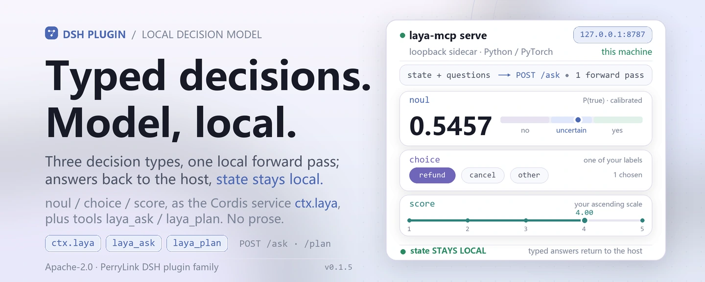
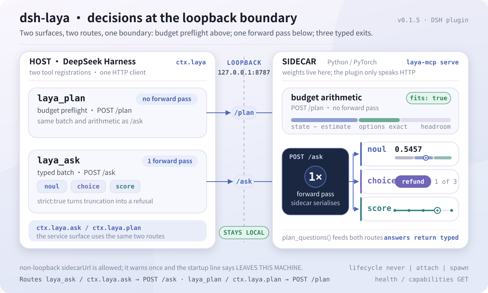

<div align="center">

<picture>
  <source media="(prefers-color-scheme: dark)" srcset="docs/assets/dsh-laya-hero-en-dark.webp">
  
</picture>

# dsh-laya

**हाँ/नहीं, कौन-सा और कितना — इन्हें एक स्थानीय फ़ॉरवर्ड पास में बदलें: संभावनाएँ होस्ट को लौटती हैं और state इस मशीन से बाहर नहीं जाता।**

Laya के टाइप्ड निर्णय (`noul`, `choice`, `score`) DeepSeek Harness में पहले दर्जे की Cordis सेवा `ctx.laya` और दो मॉडल-दृश्य टूल `laya_ask` / `laya_plan` के रूप में आते हैं: यह गद्य नहीं लिखता, केवल लेबल, कैलिब्रेटेड संभावनाएँ और स्केल पर स्थिति देता है।

[स्थापना](#तीन-चरणों-में-शुरुआत) · [कॉन्फ़िगरेशन](#कॉन्फ़िगरेशन) · [FAQ](#faq) · [简体中文](README.md) · [English](README.en.md) · [Español](README.es.md) · [Português](README.pt.md) · [हिन्दी](README.hi.md)

[](LICENSE)
[](#संगतता)
[](https://www.npmjs.com/package/dsh-laya)
[](https://github.com/PerryLink/dsh-laya/actions/workflows/ci.yml)
[](#संगतता)

[](https://github.com/PerryLink/dsh-laya/stargazers)
[](https://www.npmjs.com/package/dsh-laya)
[](https://dshfind.com/plugins/PerryLink/dsh-laya?ref=badge)

```sh
dsh plugin --profile <profile> add dsh-laya
```

</div>

<sub>समुदाय प्लगइन, DeepSeek से संबद्ध नहीं। एकमात्र रेपो: <https://github.com/PerryLink/dsh-laya>।</sub>

## यह क्या है

Laya एक ऐसा मॉडल है जो केवल टाइप्ड प्रश्नों का उत्तर देता है: `noul` सत्य होने की संभावना देता है, `choice` आपके बताए लेबल में से एक चुनता है, और `score` state को आपके घोषित क्रमबद्ध स्केल पर रखता है। `dsh-laya` के पास कोई वेट नहीं है — Laya PyTorch है, इसलिए वेट उस Python sidecar में रहते हैं जिसे आप `laya-mcp serve` से शुरू करते हैं, और यह प्लगइन केवल उसका लूपबैक HTTP क्लाइंट है।

यह harness को दो चीज़ें देता है: सेवा `ctx.laya` (`ask`, `plan`, `health`, `capabilities`, `sidecarUrl`, `loopback`) और दो मॉडल-दृश्य टूल `laya_ask` व `laya_plan`। इस तरह होस्ट कोड और अन्य प्लगइन मॉडल के एक चक्कर के बिना सीधे निर्णय माँग सकते हैं, और मॉडल एक फ़ॉरवर्ड पास खर्च करने से पहले जाँच सकता है कि प्रश्नों का बैच फ़िट होगा या नहीं।

डिफ़ॉल्ट एंडपॉइंट `http://127.0.0.1:8787` है: state इस मशीन से बाहर नहीं जाता। `sidecarUrl` को कहीं और इंगित करना अनुमत है, पर स्टार्टअप लाइन गंतव्य का नाम लेती है — वही वह क्षण है जब प्राइवेसी की कहानी बदलती है।

<div align="center">

<picture>
  <source media="(prefers-color-scheme: dark)" srcset="docs/assets/dsh-laya-flow-v5-dark.svg">
  
</picture>

</div>

## तीन चरणों में शुरुआत

दो टुकड़े, क्योंकि Laya PyTorch है और किसी Node प्लगइन के भीतर नहीं रह सकता।

1. **sidecar शुरू करें** (वही आधा हिस्सा जिसके पास वास्तव में मॉडल है):

   ```sh
   pip install "laya-mcp[mcp]"
   laya-mcp serve                      # एक बार लोड होता है, 127.0.0.1:8787 पर सुनता है
   ```

2. **यह प्लगइन इंस्टॉल करें**:

   ```sh
   dsh plugin --profile <profile> add dsh-laya
   ```

   फिर पुष्टि करें कि पंक्ति `active` है, `failed` नहीं।

3. **देखें कि sidecar ज़िंदा है, और स्टार्टअप लाइन पढ़ें**:

   ```sh
   curl -s http://127.0.0.1:8787/health
   ```

   ```text
   [dsh-laya] sidecar=http://127.0.0.1:8787 (this machine only) · lifecycle=never
   [dsh-laya] ready · tools: laya_ask laya_plan · sidecar=http://127.0.0.1:8787 · state STAYS LOCAL
   ```

   स्टार्टअप लाइन `STAYS LOCAL` पर खत्म होती है या `LEAVES THIS MACHINE` पर — यही state के गंतव्य का उत्तर है।

   *Observed from `index.js:461-464; index.js:609-612`*

**अनइंस्टॉल**: `dsh plugin --profile <profile> remove dsh-laya` (या प्रोफ़ाइल पैच से वह पंक्ति हटा दें)।

> इस प्लगइन में मॉडल नहीं है और यह खुद कोई इन्फ़रेंस नहीं चलाता: `laya_plan` कोई फ़ॉरवर्ड पास नहीं करता, पर वह भी sidecar को एक HTTP कॉल ही है। sidecar न हो तो दोनों टूल विफल होते हैं, जैसा FAQ में बताया गया है।

## मुख्य क्षमताएँ

`dsh-laya` Laya के निर्णय को होस्ट की तरफ़ जोड़ता है, एक और prompt लपेटने के बजाय:

- **एक सेवा, `ctx.laya`** — होस्ट कोड और अन्य प्लगइन सीधे माँग सकते हैं: `const laya = ctx.get('laya'); const result = await laya.ask({ state, questions })`।
- **दो टूल** — `laya_ask` टाइप्ड प्रश्नों का बैच संभालता है; `laya_plan` एक फ़ॉरवर्ड पास खर्च करने से पहले token बजट जाँचता है।
- **तीन आदिम** — `noul` (हाँ/नहीं, `no` / `uncertain` / `yes` बैंड के साथ), `choice` (आपके बताए लेबल में से एक), `score` (आपके घोषित क्रमबद्ध स्केल पर स्थिति)।
- **बजट पूर्व-जाँच** — `POST /plan` वही अंकगणित करता है जो `POST /ask` करता है, पर कोई फ़ॉरवर्ड पास नहीं; विकल्पों के आँकड़े सटीक हैं, state का आँकड़ा अक्षर-आधारित अनुमान है और `"exact": false` से चिह्नित है।
- **अर्थपूर्ण विफलताएँ** — न पहुँचना `sidecar_unreachable` है, बहुत धीमा होना `sidecar_timeout`; sidecar का अपना अस्वीकार (जैसे `state_truncated`) अपने `code` और `hint` के साथ जैसा है वैसा आगे जाता है।
- **sidecar जीवनचक्र** — `never` / `attach` / `spawn`; जो sidecar पहले से उत्तर दे रहा है उससे केवल जुड़ा जाता है, छुआ नहीं जाता, और इस प्लगइन ने जिसे शुरू किया वह अनमाउंट पर रोक दिया जाता है।
- **कन्करेंसी-सुरक्षित** — दोनों टूल `isConcurrencySafe` घोषित करते हैं, इसलिए स्वतंत्र निर्णय होस्ट के समानांतर पूल में जाते हैं; फ़ॉरवर्ड पास sidecar खुद क्रमबद्ध करता है।

```text
state + questions ──laya_ask──▶ POST /ask  ──▶ laya-mcp serve ──▶ noul / choice / score
state + questions ──laya_plan─▶ POST /plan ──▶ बजट अंकगणित (कोई फ़ॉरवर्ड पास नहीं)
```

### सेवा और टूल सतह

| सतह | फ़ॉरवर्ड पास | टिप्पणी |
|---|---|---|
| `ctx.laya.ask` | हाँ | `POST /ask` तक पासथ्रू; sidecar का कच्चा पेलोड लौटाता है |
| `ctx.laya.plan` | नहीं | `POST /plan` तक पासथ्रू, `ask` जैसा ही बजट अंकगणित |
| `ctx.laya.health` | नहीं | `GET /health`: चेकपॉइंट सूची, कॉल संख्या, `degraded` |
| `ctx.laya.capabilities` | नहीं | `GET /capabilities` |
| `ctx.laya.sidecarUrl` / `loopback` | नहीं | मौजूदा एंडपॉइंट, और क्या state इसी मशीन पर रहता है — तथ्य, नीति नहीं |
| `laya_ask` | हाँ | टाइप्ड प्रश्नों का बैच; `strict: true` कटौती को अस्वीकार में बदल देता है |
| `laya_plan` | नहीं | बजट पूर्व-जाँच; उत्तर बनाए बिना बताता है कि क्या फ़िट होगा |

### उदाहरण कॉल

`SKILL.md` से न्यूनतम प्रश्न-आकार — `laya_ask` के `questions.<id>` में यही जाता है, और साक्ष्य `state` में:

```json
{
  "type": "noul",
  "instructions": "Does the user threaten to cancel?",
  "boundary": {
    "true": "an explicit threat to cancel or not renew",
    "false": "no threat, however annoyed the tone"
  }
}
```

`choice` में `criteria` लेबल-से-विवरण का मैप है; `score` में `criteria` स्तर-विवरणों की आरोही सरणी है, कम से कम दो और हर एक का विवरण। `noul` में `criteria` छोड़ा जा सकता है, और दिया जाए तो `{"true": …, "false": …}` होना चाहिए। टूल कार्ड `noul` को `<id>=<संभावना> (<बैंड>)`, `choice` को लेबल और `score` को स्केल मान के रूप में दिखाता है।

*Observed from `index.js:256-273; index.js:341-365`*

## मापे गए आँकड़े

| मापन | मान |
|---|---|
| sidecar अनुबंध, शुरू से अंत तक (RTX 5060) | लोड 9.8 सेकंड; CUDA पर तीन प्रश्नों के लिए 411 मिलीसेकंड |
| `boundary` के बिना `noul` | 40/40 आइटम false (अंग्रेज़ी और चीनी दोनों में) — ठीक संयोग जितना |
| `boundary` के साथ `noul` | वही 40 आइटम: 1.000 और 0.975 |
| कैलिब्रेशन का एक वास्तविक उदाहरण | 0.5457, बैंड `uncertain` |

ये वे मापन हैं जो पहले ही इंटीग्रेशन परत और skill दस्तावेज़ों में हो चुके हैं, कोई ऐसा बेंचमार्क नहीं जो इस रेपो ने दोबारा चलाया हो। यहाँ `benchmark/RESULTS.md` नहीं है, इसलिए मापे गए आँकड़ों का चार्ट नहीं बनाया गया; upstream के अपने सटीकता आँकड़े «ज्ञात सीमाएँ» में हैं।

## कॉन्फ़िगरेशन

हर समायोज्य विकल्प `Config` फ़ील्ड है, और `cordis.patch.yml` में हर कुंजी पर इनलाइन टिप्पणी है। id-आधारित ओवरराइड पूरी पंक्ति बदल देता है — जिन कुंजियों की ज़रूरत हो, सब दोबारा लिखें।

सबसे अधिक उपयोग होने वाली कुंजियाँ:

| कुंजी | डिफ़ॉल्ट | अर्थ |
|---|---|---|
| `sidecarUrl` | `'http://127.0.0.1:8787'` | sidecar का पता। लूपबैक = state इस मशीन से बाहर नहीं जाता; कहीं और इंगित करने पर प्राइवेसी की कहानी बदलती है और स्टार्टअप पर एक बार चेतावनी आती है, गंतव्य का नाम लेकर |
| `lifecycle` | `never` | `sidecarUrl` पर कोई उत्तर न दे तो क्या करें: `never` / `attach` / `spawn` (नीचे देखें) |
| `spawnCommand` | `null` | `lifecycle: spawn` के लिए चलाने वाला कमांड, argv शैली में। कोई डिफ़ॉल्ट नहीं — यह प्लगइन इंटरप्रेटर का अनुमान नहीं लगाता |
| `requestTimeoutMs` | `120000` | प्रति-अनुरोध टाइमआउट। गरम इन्फ़रेंस 30–500 मिलीसेकंड है, पर ठंडे स्टार्ट के बाद पहला कॉल मॉडल लोड का इंतज़ार कर सकता है |
| `logLevel` | `info` | `silent` / `warn` / `info` / `debug`। `debug` शुरू किए गए sidecar का stdout / stderr पंक्ति-दर-पंक्ति दर्ज करता है |

`lifecycle` तय करता है कि `sidecarUrl` पर कोई उत्तर न देने पर क्या हो:

| | |
|---|---|
| `never` | कुछ भी शुरू न करें; मान लें कि कुछ और sidecar संभाल रहा है। डिफ़ॉल्ट। |
| `attach` | लोड पर एक बार `/health` भी जाँचें और जो मिला उसे लॉग करें — जब harness और sidecar स्टार्टअप पर होड़ करें तब उपयोगी। |
| `spawn` | कोई उत्तर न दे तो `spawnCommand` भी चलाएँ, फिर उसके ऊपर आने की प्रतीक्षा करें। |

`spawn` इसलिए है क्योंकि विकल्प उससे बुरा था। प्लगइन अब भी कुछ इंस्टॉल या डाउनलोड नहीं करता — कोई टूल चुपचाप `pip install` चलाकर 650 MB का चेकपॉइंट ले आए, वह कितना भी सुविधाजनक हो, शत्रुतापूर्ण ही होगा, और यह बात नहीं बदली। पर *जो sidecar आप पहले ही इंस्टॉल कर चुके हैं उसे शुरू करना* अलग काम है; इसके बिना हर सेशन टर्मिनल में हाथ से Python प्रक्रिया शुरू करने से आरंभ होता था, और वह प्रक्रिया जाते ही फिर विफल होने लगता था।

दो नियम इसे चालू छोड़ना सुरक्षित बनाते हैं:

* जो sidecar पहले से उत्तर दे रहा है, उससे **केवल जुड़ा जाता है, उसे कभी छुआ नहीं जाता**, इसलिए दो harness सेशन एक ही पोर्ट पर दो मॉडल नहीं रख सकते।
* इस प्लगइन ने जो sidecar शुरू किया, वह **प्लगइन अनमाउंट होने पर रोक दिया जाता है**; जो इसने शुरू नहीं किया, वह ठीक वैसा ही रहता है जैसा मिला था।

यह अलगाव गरम मॉडल भी देता है: Laya का ठंडा निर्माण कुछ सेकंड से लेकर दसियों सेकंड तक लेता है, और उसका डिफ़ॉल्ट आलसी router हर भाषा बदलाव पर चेकपॉइंट फिर बनाता है। `laya-mcp serve` यह कीमत एक बार चुकाता है।

Windows पर कंसोल स्क्रिप्ट `.cmd` शिम होती है, जिसे यह `cmd.exe /c` के ज़रिए हल करता है; `python -m laya_mcp` पर इंगित करना इससे पूरी तरह बच जाता है।

<details>
<summary>पूरी कॉन्फ़िगरेशन तालिका (6 कुंजियाँ)</summary>

| कुंजी | डिफ़ॉल्ट | अर्थ |
|---|---|---|
| `sidecarUrl` | `'http://127.0.0.1:8787'` | sidecar का पता; http(s) URL होना चाहिए। डिफ़ॉल्ट रूप से लूपबैक — sidecar में कोई प्रमाणीकरण नहीं है और इसे बाहर उजागर नहीं करना चाहिए |
| `requestTimeoutMs` | `120000` | प्रति-अनुरोध टाइमआउट (मिलीसेकंड)। ठंडे स्टार्ट के बाद पहला कॉल मॉडल लोड का इंतज़ार कर सकता है, इसलिए यह जानबूझकर उदार है |
| `lifecycle` | `never` | `never` मानता है कि कुछ और sidecar संभाल रहा है; `attach` लोड पर एक बार `/health` जाँचकर दर्ज करता है; `spawn` कोई उत्तर न देने पर `spawnCommand` चलाता है |
| `spawnCommand` | `null` | `spawn` के लिए कमांड, argv शैली में, जैसे `['laya-mcp', 'serve']` या `['python', '-m', 'laya_mcp', 'serve', '--model', 'english']`। लोड पर ही सत्यापित होता है, इसलिए टाइपो स्टार्टअप पर फ़ील्ड का नाम लेकर विफल होता है |
| `spawnTimeoutMs` | `120000` | शुरू किए गए sidecar के `/health` का उत्तर आने तक कितनी प्रतीक्षा करें, मिलीसेकंड में। टाइमआउट सूचित होता है, घातक नहीं: sidecar जैसे ही उत्तर देगा, टूल काम करने लगेंगे |
| `logLevel` | `info` | `silent` / `warn` / `info` / `debug` |

अमान्य मान लोड पर ज़ोर से विफल होते हैं: `sidecarUrl` खाली नहीं और http(s) हो; दोनों टाइमआउट धनात्मक हों; `lifecycle` तीन में से एक हो; `spawnCommand` गैर-रिक्त स्ट्रिंग्स की गैर-रिक्त सरणी हो; `logLevel` चार में से एक हो।

</details>

प्रोफ़ाइल पैच में ओवरराइड का उदाहरण:

```yaml
- insert:
    - id: laya
      name: 'dsh-laya'
      config:
        sidecarUrl: 'http://127.0.0.1:8787'
        requestTimeoutMs: 120000
        lifecycle: never      # 'attach' पहुँच-जाँच लॉग करता है,
                              # 'spawn' sidecar खुद शुरू करता है
        spawnCommand: null    # 'spawn' के लिए आवश्यक, जैसे ['laya-mcp', 'serve']
        spawnTimeoutMs: 120000
        logLevel: info
```

## FAQ

<details>
<summary>state असल में कहाँ जाता है? क्या वह क्लाउड तक पहुँच सकता है?</summary>

केवल `sidecarUrl` तक। डिफ़ॉल्ट `127.0.0.1:8787` है, यानी यही मशीन, और तब स्टार्टअप लाइन `state STAYS LOCAL` कहती है। `sidecarUrl` को गैर-लूपबैक होस्ट पर इंगित करना अनुमत है, पर वह स्टार्टअप पर एक बार चेतावनी देता है और गंतव्य का नाम लेता है — वही वह क्षण है जब प्राइवेसी की कहानी बदलती है। प्लगइन खुद कुछ इंस्टॉल या डाउनलोड नहीं करता, कोई टेलीमेट्री नहीं भेजता और state कहीं कैश नहीं करता।

</details>

<details>
<summary>sidecar बंद हो या मर जाए तो क्या होगा? चुपचाप विफल होगा?</summary>

कुछ भी चुपचाप नहीं होता। sidecar तक न पहुँचने पर टूल `sidecar_unreachable` लौटाते हैं, टाइमआउट पर `sidecar_timeout`, और दोनों कहते हैं कि पहले `laya-mcp serve` शुरू करें; टूल पंजीकृत रहते हैं और जैसे ही कोई उत्तर देता है, ठीक हो जाते हैं। `lifecycle: attach` लोड पर एक बार `/health` जाँचकर परिणाम लॉग करता है; `lifecycle: spawn` कोई उत्तर न देने पर `spawnCommand` चलाता है, और स्टार्टअप टाइमआउट चेतावनी देता है पर घातक नहीं होता; शुरू किया गया sidecar बाहर निकले तो एक दृश्य चेतावनी दर्ज होती है।

</details>

<details>
<summary>क्या यह अन्य प्लगइनों से टूल नाम, सेवा कुंजी या slot के लिए टकराता है?</summary>

नहीं। टूल नाम नेमस्पेस वाले हैं (`laya_ask`, `laya_plan`), यह ठीक एक सेवा कुंजी `laya` प्रकाशित करता है, `inject` केवल `tools` की प्रतीक्षा करता है, और कोई कमांड, क्लाइंट slot, `webServer` प्रीफ़िक्स पंजीकृत नहीं करता, न ही ग्लोबल बदलता है। बिंदु-दर-बिंदु तर्क «अन्य DSH प्लगइनों के साथ इंटरऑपरेबिलिटी» में है।

</details>

<details>
<summary>Python sidecar अलग से क्यों इंस्टॉल करना पड़ता है? अंदर क्यों नहीं रख सकते?</summary>

क्योंकि Laya PyTorch है और वेट कई सौ मेगाबाइट का चेकपॉइंट हैं जो किसी Node प्लगइन में नहीं समा सकते। जो प्लगइन चुपचाप `pip install` चलाकर वेट डाउनलोड करे, वह कितना भी सुविधाजनक हो, शत्रुतापूर्ण होगा, इसलिए यह केवल क्लाइंट है; `lifecycle: spawn` भी वही कमांड चलाता है जो आप **पहले ही इंस्टॉल कर चुके हैं**, और `spawnCommand` का कोई डिफ़ॉल्ट नहीं है।

</details>

<details>
<summary>आउटपुट कैसे पढ़ें? `confidence` और कटौती में क्या सावधानी है?</summary>

`confidence` सटीकता नहीं, विकल्पों पर सांद्रता का आँकड़ा है: शीर्ष विकल्प सही होने पर भी संभावना बिखरी हो तो वह कम होती है, और आत्मविश्वास से गलत उत्तर पर ऊँची। इसलिए `noul` के साथ `no` / `uncertain` / `yes` बैंड भी आता है — 0.5457 और `uncertain` इसी स्टैक का वास्तविक उदाहरण है। कटौती उलटी समस्या है: बहुत बड़ा state बिना बताए **अंत से** काट दिया जाता है और उत्तर बचे हुए उपसर्ग के बारे में होता है; `truncated`, `budget_summary` और `warnings` पढ़ें, या पहले `laya_plan` बुलाएँ।

</details>

## सुरक्षा सीमाएँ

- **कोई इंस्टॉल नहीं, कोई डाउनलोड नहीं।** इस प्लगइन में कोई वेट नहीं है और यह `pip install` नहीं चलाता; `lifecycle: spawn` केवल वही कमांड चलाता है जिसे ऑपरेटर स्पष्ट रूप से नाम दे, और `spawnCommand` का कोई डिफ़ॉल्ट नहीं, इसलिए यह इंटरप्रेटर का अनुमान कभी नहीं लगाता।
- **गंतव्य दृश्य है।** state केवल `sidecarUrl` पर भेजा जाता है; गैर-लूपबैक पता स्टार्टअप पर एक बार चेतावनी देकर गंतव्य का नाम लेता है, और स्टार्टअप लाइन हमेशा `STAYS LOCAL` या `LEAVES THIS MACHINE` बताती है।
- **sidecar में प्रमाणीकरण नहीं है।** यह डिफ़ॉल्ट रूप से `127.0.0.1:8787` पर बंधता है; इसे इंटरनेट पर उजागर न करें और `sidecarUrl` को साझा होस्ट पर न ले जाएँ।
- **कोई अधिग्रहण नहीं।** जो sidecar पहले से उत्तर दे रहा है उससे केवल जुड़ा जाता है, छुआ नहीं जाता, इसलिए दो harness सेशन एक ही पोर्ट पर दो मॉडल नहीं रख सकते; यह प्लगइन केवल अपने शुरू किए sidecar को रोकता है और बाकी हर प्रक्रिया को ठीक वैसा ही छोड़ता है जैसा मिला था।
- **गलत कॉन्फ़िगरेशन लोड पर विफल होता है।** अमान्य `sidecarUrl`, गैर-धनात्मक टाइमआउट, अज्ञात `lifecycle`, विकृत `spawnCommand` या अज्ञात `logLevel` पहले टूल कॉल की प्रतीक्षा करने के बजाय स्टार्टअप पर फ़ील्ड का नाम लेकर ज़ोर से विफल होते हैं।
- **पंजीकरण effect हैं।** सेवा, टूल और sidecar जीवनचक्र सब Cordis effect पर टिके हैं — रोकने या हॉट-रीलोड पर वे हट जाते हैं, और इस प्लगइन ने जो sidecar शुरू किया वह भी रुक जाता है।

## अनुमतियाँ और डेटा

- **अनुमतियाँ**: `package.json` का `dsh.capabilities` केवल `network:egress` घोषित करता है। प्लगइन कोई फ़ाइल नहीं लिखता, कोई कैश नहीं रखता और कोई क्रेडेंशियल संग्रहीत नहीं करता; उसका एकमात्र फ़ाइलसिस्टम काम `PATH` पर `spawnCommand` हल करना है (`sidecar.js` में `existsSync`)।
- **डेटा**: अनुरोध बॉडी (`state` + `questions`) जैसी है वैसी `sidecarUrl` को भेजी जाती है, डिफ़ॉल्ट रूप से लूपबैक; प्लगइन डिस्क पर कुछ नहीं लिखता, कैश नहीं करता और उसकी कोई टेलीमेट्री नहीं है।
- **लॉग**: केवल स्टार्टअप लाइन, स्वास्थ्य सारांश और त्रुटियाँ; `logLevel` विस्तार नियंत्रित करता है और `debug` शुरू किए गए sidecar का stdout / stderr पंक्ति-दर-पंक्ति दर्ज करता है ताकि Python traceback दिखता रहे।
- **सेशन**: टूल के `answers`, `truncated`, `budget_summary` और `warnings` ठीक वही हैं जो मॉडल देखता है; प्लगइन सेशन लॉग में कुछ नहीं जोड़ता।

## ज्ञात सीमाएँ

- **upstream की सटीकता ही ऊपरी सीमा है।** upstream के अपने मापन दोहराए गए हैं, क्योंकि उलटा संकेत देने वाला इंटीग्रेशन आपसे झूठ बोल रहा है: आधार चेकपॉइंट टाइप्ड निर्णयों पर **शून्य-शॉट में संयोग के क़रीब** हैं (अंग्रेज़ी 0.362, जबकि बहुसंख्यक-वर्ग आधार 0.461 है); `score` सबसे कमज़ोर आदिम है (स्वतंत्र मापन में Jev के 70% के मुक़ाबले 35%); तापमान फ़िटिंग से पहले कच्ची कैलिब्रेशन त्रुटि 0.466 है; और लगभग 20 से अधिक विकल्पों पर सटीकता गिरती है। कैलिब्रेशन संभावना को ईमानदार बनाता है। वह मॉडल को सही नहीं बनाता।
- **चुपचाप कटौती।** बहुत बड़ा state **अंत से** काट दिया जाता है, उत्तर बचे हुए उपसर्ग के बारे में होता है, और Laya का अपना आउटपुट यह स्वीकार नहीं करता। उत्तर इसे `truncated` में बताता है और `laya_plan` पूछने से पहले ही बता देता है; अस्वीकार करने के लिए `strict: true` दें — जीवित sidecar के विरुद्ध सत्यापित, जो HTTP 400, `state_truncated` और `max_len` का नाम लेने वाला संकेत लौटाता है।
- **`confidence` सटीकता नहीं है।** यह सांद्रता का आँकड़ा है: संभावना विकल्पों में बिखरी हो तो कम — भले शीर्ष विकल्प सही हो; और आत्मविश्वास से गलत उत्तर पर ऊँची। `noul` के साथ `no` / `uncertain` / `yes` बैंड भी आता है, क्योंकि कैलिब्रेटेड संभावना निर्णय नहीं है — इस स्टैक का एक वास्तविक मापा उदाहरण 0.5457 और बैंड `uncertain` लौटाया।
- **चुपचाप CPU पर गिरना सूचित होता है।** यदि डिवाइस त्रुटि के बाद Laya CPU पर लौटता है तो वह कभी त्वरक पर नहीं लौटता, और उसके अपने आउटपुट में कोई यह स्वीकार नहीं करता। स्वास्थ्य सतह `degraded` रखती है और टूल कार्ड `CPU (degraded)` जोड़ता है।
- **भाषा कवरेज सीमित है।** डिटेक्टर केवल en / fr / de / es / pt / it / nl कवर करता है; लैटिन लिपि की बाकी भाषाएँ चुपचाप अंग्रेज़ी चेकपॉइंट पर भेज दी जाती हैं, जो फिर आत्मविश्वास से गलत उत्तर देता है। भाषा स्थिर करने के लिए `laya_ask` को `lang` दें (जैसे `"de"`)।
- **sidecar आपको खुद देना होगा।** इस प्लगइन में मॉडल नहीं है: `laya-mcp serve` न चल रहा हो तो टूल `sidecar_unreachable` (या बहुत धीमा हो तो `sidecar_timeout`) लौटाते हैं।
- **स्थिति (विकासाधीन)।** प्लगइन harness में माउंट और सक्रिय होता है, और उसका sidecar अनुबंध RTX 5060 पर शुरू से अंत तक सत्यापित है (लोड 9.8 सेकंड, CUDA पर तीन प्रश्नों के लिए 411 मिलीसेकंड); CI में किसी जीवित मॉडल टर्न से अभी परखा नहीं गया है।

## अन्य DSH प्लगइनों के साथ इंटरऑपरेबिलिटी

`index.js` और `cordis.patch.yml` की वास्तविक पंजीकरण सतह के विरुद्ध सत्यापित। यह प्लगइन अन्य प्लगइनों में बाधा नहीं डालता:

- **केवल एक सेवा उपभोग।** `inject = ['tools']`, और बस वही: Cordis प्लगइन को `inject` की हर कुंजी की प्रतीक्षा कराता है, इसलिए ऐसी सेवा जोड़ना जिसे अधिकांश प्रोफ़ाइल नहीं जोड़ते (जैसे `skills`) प्लगइन को हमेशा `pending` रखेगा।
- **नेमस्पेस वाले टूल।** `laya_ask` और `laya_plan`; किसी अंतर्निहित टूल या अन्य प्लगइन का कोई नंगा नाम पंजीकृत नहीं होता।
- **केवल एक सेवा कुंजी प्रकाशित।** `laya`; इसके अलावा कुछ नहीं, इसलिए सेवा कुंजी पर टकराव संभव नहीं।
- **कोई कमांड, slot या HTTP रूट नहीं।** कोई DSH कमांड, क्लाइंट slot कुंजी या `webServer` प्रीफ़िक्स पंजीकृत नहीं।
- **patch परत का टकराव नहीं।** बंडल patch केवल अपनी पंक्ति `insert` करता है; वह अंतर्निहित पंक्ति का `config` कभी नहीं लिखता।
- **कोई ग्लोबल बदलाव नहीं।** न प्रोटोटाइप बदलता है, न `process.env` लिखता है, न वैश्विक fetch dispatcher बदलता है।
- **साझा इवेंट listener नहीं।** यह कभी `ctx.on(...)` नहीं बुलाता, इसलिए क्रम-संवेदी इवेंट पर होड़ में नहीं पड़ता और किसी श्रृंखला को शॉर्ट-सर्किट नहीं कर सकता।
- **कन्करेंसी घोषणा।** दोनों टूल `isConcurrencySafe` घोषित करते हैं, इसलिए स्वतंत्र निर्णय होस्ट के समानांतर पूल में जाते हैं; फ़ॉरवर्ड पास sidecar खुद क्रमबद्ध करता है।

## संगतता

| पहलू | स्थिति |
|---|---|
| Harness | `dsh-v0.1.7-alpha.1` के विरुद्ध सत्यापित (यही वह होस्ट रिलीज़ है जिसके लिए यह बिल्ड है); `>=0.1.7-alpha.1 <0.3.0` चाहिए (`package.json` में `engines.dsh`) |
| Node | `^22.19.0 \|\| >=24.0.0` (CI Node 22 और 24 पर चलता है) |
| प्लेटफ़ॉर्म | जहाँ DSH चले, साथ में स्थानीय Python sidecar (PyTorch); RTX 5060 / CUDA पर सत्यापित, और CPU पर गिरना `degraded` के रूप में सूचित होता है |
| मॉडल | Laya चेकपॉइंट (`noul` / `choice` / `score`); यह जनरेटिव मॉडल नहीं है और टेक्स्ट, कोड या कमांड नहीं लिख सकता |
| CI | `ubuntu-latest` और `windows-latest` × Node 22 / 24: `npm test` + `npm run check:readmes` |

## इकोसिस्टम और गुणवत्ता

- [npm पैकेज](https://www.npmjs.com/package/dsh-laya) (अभी 0.1.5)
- [dshfind प्लगइन पेज](https://dshfind.com/plugins/PerryLink/dsh-laya) (इंस्टॉल और रैंकिंग; बैज का वही स्रोत)
- [Laya upstream](https://github.com/NandhaKishorM/laya) (मॉडल वेट और `laya-mcp` sidecar का स्रोत; Apache-2.0)
- **CI**: [`.github/workflows/ci.yml`](.github/workflows/ci.yml) दो OS × दो Node संस्करणों पर `npm test` और `npm run check:readmes` चलाता है, जानबूझकर बिना `npm install` चरण के — परीक्षण केवल शुद्ध सतह (`plan.js`, `sidecar.js`) कवर करते हैं और उन्हें माउंटेड harness की ज़रूरत नहीं।

## डेवलपमेंट

```sh
npm test                 # node --test (plan.js / sidecar.js की शुद्ध सतह)
npm run check:readmes    # पाँच भाषाओं के README की सिंक: अनुभाग / इंस्टॉल कमांड / कुंजियाँ
npm pack                 # प्रकाशित tarball
```

कोई बिल्ड चरण नहीं: शुद्ध ESM; `index.js`, `plan.js` और `sidecar.js` ही प्रकाशित आर्टिफ़ैक्ट हैं; `SKILL.md` और `cordis.patch.yml` भी साथ जाते हैं (`package.json` में `files` देखें)।

README की तस्वीरें [`scripts/gen-readme-assets.py`](scripts/gen-readme-assets.py) से कार्यक्रमपूर्वक बनती हैं (Python + Pillow, CJK फ़ॉन्ट जाँच सहित) और दोबारा चलाई जा सकती हैं: `python scripts/gen-readme-assets.py`।

संरचना:

```text
index.js            Cordis प्लगइन: Config सत्यापन, ctx.laya सेवा, laya_ask / laya_plan टूल
plan.js             बजट पूर्व-जाँच की शुद्ध सतह (आउटपुट schema, आकार देना, सारांश)
sidecar.js          spawn हल करना और जीवनचक्र (PATH खोज, cmd.exe /c, प्रक्रिया रोकना)
SKILL.md            एजेंट के लिए Laya के निर्देश (पैकेज में जाते हैं)
cordis.patch.yml    बंडल पंक्ति; हर Config कुंजी पर इनलाइन टिप्पणी
test/               node --test (plan / sidecar)
scripts/            यांत्रिक द्वार: check-readme-sync.mjs, gen-readme-assets.py
```

Topics: `dsh-plugin`, `deepseek-harness`, `cordis`, `laya`, `decision-model`, `system-one`, `typed-decisions`

## परिवार और आभार

यह परियोजना [PerryLink](https://github.com/PerryLink) द्वारा अनुरक्षित DeepSeek Harness प्लगइन परिवार का हिस्सा है (सभी Apache-2.0)। अगर यह उपयोगी हो, **एक star अगले व्यक्ति को इसे खोजने में मदद करता है** — इसके पीछे कुछ भी बंद नहीं है।

- [@PerryLink](https://github.com/PerryLink) — निर्माता और अनुरक्षक: `ctx.laya` सेवा, `laya_ask` / `laya_plan` टूल, sidecar जीवनचक्र (`never` / `attach` / `spawn`) और पाँच भाषाओं का दस्तावेज़।
- [Convai Innovations / Laya](https://github.com/NandhaKishorM/laya) — upstream मॉडल और `laya-mcp` sidecar के लेखक; यह प्लगइन एक स्वतंत्र इंटीग्रेशन है, उस परियोजना का आधिकारिक घटक नहीं।

<details>
<summary>सभी प्लगइन दिखाएँ</summary>

| प्लगइन | स्थिति |
|---|---|
| **[dsh-auto-review](https://github.com/PerryLink/dsh-auto-review)** |  |
| **[dsh-autotier](https://github.com/PerryLink/dsh-autotier)** | 🧊 फ़्रोज़न — रेपो README देखें |
| **[dsh-background-agents](https://github.com/PerryLink/dsh-background-agents)** | 🚫 रिटायर्ड (रेपो संग्रहीत) |
| **[dsh-budget](https://github.com/PerryLink/dsh-budget)** | 🧊 फ़्रोज़न — रेपो README देखें |
| **[dsh-catalog](https://github.com/PerryLink/dsh-catalog)** |  |
| **[dsh-cert-mcp](https://github.com/PerryLink/dsh-cert-mcp)** | 🧊 फ़्रोज़न — रेपो README देखें |
| **[dsh-checkpoint-rewind](https://github.com/PerryLink/dsh-checkpoint-rewind)** |  |
| **[dsh-claude-move](https://github.com/PerryLink/dsh-claude-move)** | 🧊 फ़्रोज़न — रेपो README देखें |
| **[dsh-click](https://github.com/PerryLink/dsh-click)** |  |
| **[dsh-composer-history](https://github.com/PerryLink/dsh-composer-history)** |  |
| **[dsh-data-quality](https://github.com/PerryLink/dsh-data-quality)** | 🧊 फ़्रोज़न — रेपो README देखें |
| **[dsh-defend](https://github.com/PerryLink/dsh-defend)** | 🧊 फ़्रोज़न — रेपो README देखें |
| **[dsh-doublecheck](https://github.com/PerryLink/dsh-doublecheck)** |  |
| **[dsh-draw](https://github.com/PerryLink/dsh-draw)** | 🧊 फ़्रोज़न — रेपो README देखें |
| **[dsh-fast](https://github.com/PerryLink/dsh-fast)** |  |
| **[dsh-fund-research](https://github.com/PerryLink/dsh-fund-research)** |  |
| **[dsh-github](https://github.com/PerryLink/dsh-github)** |  |
| **[dsh-industry-research](https://github.com/PerryLink/dsh-industry-research)** |  |
| **[dsh-laya](https://github.com/PerryLink/dsh-laya)** |  |
| **[dsh-library](https://github.com/PerryLink/dsh-library)** |  |
| **[dsh-local-ai](https://github.com/PerryLink/dsh-local-ai)** |  |
| **[dsh-lsp-actions](https://github.com/PerryLink/dsh-lsp-actions)** |  |
| **[dsh-mask](https://github.com/PerryLink/dsh-mask)** |  |
| **[dsh-mcp-panel](https://github.com/PerryLink/dsh-mcp-panel)** |  |
| **[dsh-memento](https://github.com/PerryLink/dsh-memento)** | 🧊 फ़्रोज़न — रेपो README देखें |
| **[dsh-observe](https://github.com/PerryLink/dsh-observe)** |  |
| **[dsh-output-styles](https://github.com/PerryLink/dsh-output-styles)** |  |
| **[dsh-permission-rules](https://github.com/PerryLink/dsh-permission-rules)** |  |
| **[dsh-plugin-certification](https://github.com/PerryLink/dsh-plugin-certification)** | 🚫 रिटायर्ड (रेपो संग्रहीत) |
| **[dsh-plugin-doctor](https://github.com/PerryLink/dsh-plugin-doctor)** | 🚫 रिटायर्ड (रेपो संग्रहीत) |
| **[dsh-plugin-guide](https://github.com/PerryLink/dsh-plugin-guide)** |  |
| **[dsh-plugin-kit](https://github.com/PerryLink/dsh-plugin-kit)** | 🚫 रिटायर्ड (रेपो संग्रहीत) |
| **[dsh-plugin-upgrade](https://github.com/PerryLink/dsh-plugin-upgrade)** | 🚫 रिटायर्ड (रेपो संग्रहीत) |
| **[dsh-plugin-upgrade-015](https://github.com/PerryLink/dsh-plugin-upgrade-015)** | 🚫 रिटायर्ड (रेपो संग्रहीत) |
| **[dsh-reach](https://github.com/PerryLink/dsh-reach)** | 🧊 फ़्रोज़न — रेपो README देखें |
| **[dsh-research-report](https://github.com/PerryLink/dsh-research-report)** |  |
| **[dsh-score](https://github.com/PerryLink/dsh-score)** | 🧊 फ़्रोज़न — रेपो README देखें |
| **[dsh-session-pin](https://github.com/PerryLink/dsh-session-pin)** | 🚫 रिटायर्ड (रेपो संग्रहीत) |
| **[dsh-session-sync](https://github.com/PerryLink/dsh-session-sync)** |  |
| **[dsh-skill-pack-security](https://github.com/PerryLink/dsh-skill-pack-security)** |  |
| **[dsh-talk](https://github.com/PerryLink/dsh-talk)** |  |
| **[dsh-team-rooms](https://github.com/PerryLink/dsh-team-rooms)** | 🚫 रिटायर्ड (रेपो संग्रहीत) |
| **[dsh-test-drive](https://github.com/PerryLink/dsh-test-drive)** |  |
| **[dsh-ticktick](https://github.com/PerryLink/dsh-ticktick)** | 🚫 रिटायर्ड (रेपो संग्रहीत) |
| **[dsh-translate](https://github.com/PerryLink/dsh-translate)** |  |

</details>

## लाइसेंस

[LICENSE](LICENSE) (Apache License 2.0) © 2026 dsh-laya contributors. Laya, Convai Innovations द्वारा Apache-2.0 के अंतर्गत है; यह एक स्वतंत्र इंटीग्रेशन है और उस upstream परियोजना से संबद्ध या उसकी अनुमोदित नहीं है।

<p align="center"><sub>Apache-2.0 · समुदाय प्लगइन, DeepSeek से संबद्ध नहीं।</sub></p>
