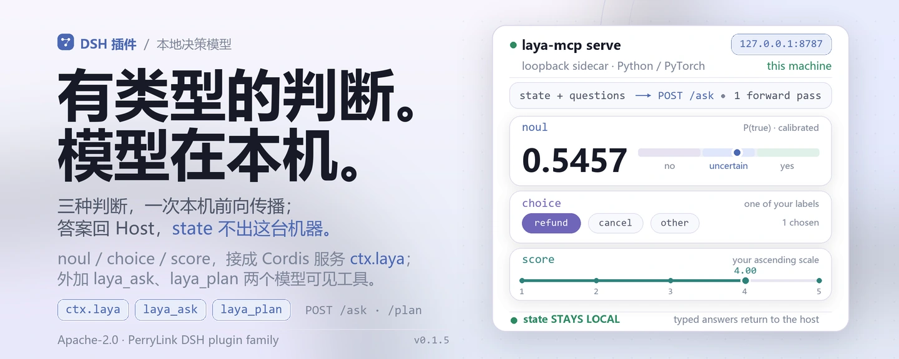
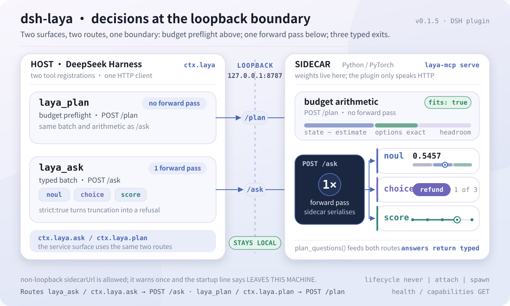
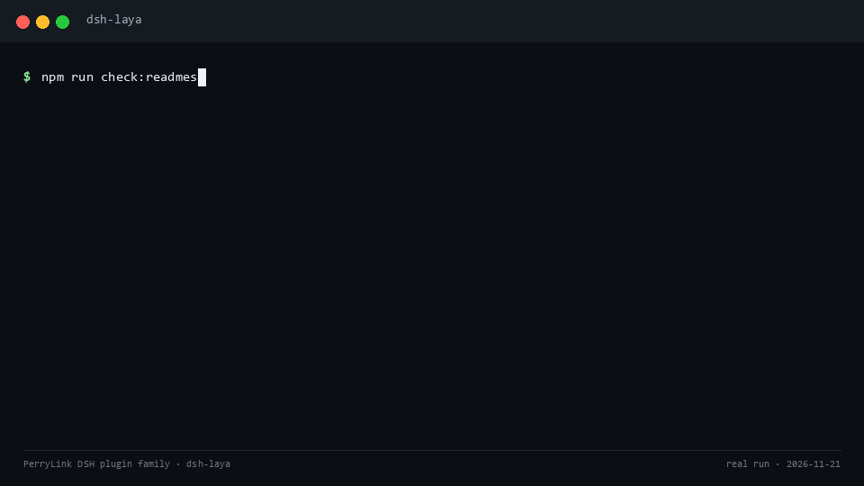

<div align="center">

<picture>
  <source media="(prefers-color-scheme: dark)" srcset="docs/assets/dsh-laya-hero-zh-dark.webp">
  
</picture>

# dsh-laya

**把「是/否、选哪个、打几分」变成一次本地前向传播——概率回到 Host，state 不出这台机器。**

Laya 的有类型决策（`noul`、`choice`、`score`）以一等 Cordis 服务 `ctx.laya` 与两个模型可见工具 `laya_ask` / `laya_plan` 接入 DeepSeek Harness：它不写散文，只回标签、标定过的概率与刻度位置。

最近一次核验：DeepSeek Harness `dsh-v0.2.3-alpha.1`（2026-11-22）。

[安装](#三步上手) · [配置](#配置) · [FAQ](#faq) · [简体中文](README.md) · [English](README.en.md) · [Español](README.es.md) · [Português](README.pt.md) · [हिन्दी](README.hi.md)

[](LICENSE)
[](#兼容性)
[](https://www.npmjs.com/package/dsh-laya)
[](https://github.com/PerryLink/dsh-laya/actions/workflows/ci.yml)
[](#兼容性)

[](https://github.com/PerryLink/dsh-laya/stargazers)
[](https://www.npmjs.com/package/dsh-laya)
[](https://dshfind.com/plugins/PerryLink/dsh-laya?ref=badge)

```sh
dsh plugin --profile <profile> add dsh-laya
```

</div>

<sub>社区插件，与 DeepSeek 官方无关。唯一仓库：<https://github.com/PerryLink/dsh-laya>。</sub>

## 它是什么

Laya 是一个只回答有类型判断的模型：`noul` 给出「真」的概率，`choice` 从你命名的标签里挑一个，`score` 在你声明、按升序排好的刻度上定位。`dsh-laya` 不持有权重——Laya 是 PyTorch，权重住在你用 `laya-mcp serve` 启动的 Python sidecar 里，本插件只是它的回环 HTTP 客户端。

它向 Harness 贡献两样东西：服务 `ctx.laya`（`ask`、`plan`、`health`、`capabilities`、`sidecarUrl`、`loopback`），以及两个模型可见工具 `laya_ask` 与 `laya_plan`。于是 Host 代码和其他插件可以直接要一个判断，不必绕一趟模型；模型也能在花掉一次前向传播之前，先问 `laya_plan` 这批问题装不装得下。

默认端点 `http://127.0.0.1:8787`：state 不出这台机器。把 `sidecarUrl` 指到别处是允许的，只是启动行会点名目的地——那是隐私故事改变的时刻。

<div align="center">

<picture>
  <source media="(prefers-color-scheme: dark)" srcset="docs/assets/dsh-laya-flow-v5-dark.svg">
  
</picture>

</div>

## 三步上手



*本仓库真实运行的动图回放（2026-11-21）。*

两块，因为 Laya 是 PyTorch，无法住在一个 Node 插件里。

1. **先起 sidecar**（真正持有模型的那一半）：

   ```sh
   pip install "laya-mcp[mcp]"
   laya-mcp serve                      # 加载一次，监听 127.0.0.1:8787
   ```

2. **装本插件**：

   ```sh
   dsh plugin --profile <profile> add dsh-laya
   ```

   装完确认该行是 `active` 而不是 `failed`。

3. **看 sidecar 是否在线，再读启动行**：

   ```sh
   curl -s http://127.0.0.1:8787/health
   ```

   ```text
   [dsh-laya] sidecar=http://127.0.0.1:8787 (this machine only) · lifecycle=never
   [dsh-laya] ready · tools: laya_ask laya_plan · sidecar=http://127.0.0.1:8787 · state STAYS LOCAL
   ```

   启动行的结尾是 `STAYS LOCAL` 还是 `LEAVES THIS MACHINE`，就是 state 去向的答案。

   *Observed from `index.js:461-464; index.js:609-612`*

**卸载**：`dsh plugin --profile <profile> remove dsh-laya`（或从 profile patch 里删掉该行）。

> 本插件不自带模型、不跑推理：`laya_plan` 虽然不触发前向传播，但仍然是一次到 sidecar 的 HTTP 调用。sidecar 不在时两个工具都会失败，失败方式见「FAQ」。

## 核心能力

`dsh-laya` 把 Laya 的判断能力接到 Host 侧，而不是再包一层 prompt：

- **一个服务，`ctx.laya`** —— Host 代码与其他插件可以直接要判断：`const laya = ctx.get('laya'); const result = await laya.ask({ state, questions })`。
- **两个工具** —— `laya_ask` 处理一批有类型问题；`laya_plan` 在花掉一次前向传播之前检查 token 预算。
- **三种原语** —— `noul`（是/否，附带 `no` / `uncertain` / `yes` 分带）、`choice`（从你声明的标签里挑一个）、`score`（在你声明的有序刻度上定位）。
- **预算预检** —— `POST /plan` 与 `POST /ask` 共用同一套算术，不跑前向传播；选项数字精确，state 数字是字符估算并标注 `"exact": false`。
- **失败有语义** —— 连不上是 `sidecar_unreachable`，超时是 `sidecar_timeout`；sidecar 自己算出的拒绝（例如 `state_truncated`）带着它的 `code` 与 `hint` 原样透传。
- **sidecar 生命周期** —— `never` / `attach` / `spawn` 三档；已经在应答的 sidecar 只连接、绝不触碰，本插件启动的 sidecar 在卸载时停止。
- **并发安全** —— 两个工具都声明 `isConcurrencySafe`，独立判断进入宿主的并行池；前向传播由 sidecar 自己串行化。

```text
state + questions ──laya_ask──▶ POST /ask  ──▶ laya-mcp serve ──▶ noul / choice / score
state + questions ──laya_plan─▶ POST /plan ──▶ 预算算术（不跑前向传播）
```

### 服务与工具面

| 表面 | 触发前向传播 | 说明 |
|---|---|---|
| `ctx.laya.ask` | 是 | 透传 `POST /ask`，返回 sidecar 的原始载荷 |
| `ctx.laya.plan` | 否 | 透传 `POST /plan`，与 `ask` 同一套预算算术 |
| `ctx.laya.health` | 否 | `GET /health`：checkpoint 列表、调用数、`degraded` |
| `ctx.laya.capabilities` | 否 | `GET /capabilities` |
| `ctx.laya.sidecarUrl` / `loopback` | 否 | 当前端点，以及 state 是否留在本机——事实，不是策略 |
| `laya_ask` | 是 | 一批有类型问题；`strict: true` 可把截断变成拒绝 |
| `laya_plan` | 否 | 预算预检；只看装不装得下，不产生答案 |

### 调用示例

`SKILL.md` 里的最小问题形态——`laya_ask` 的 `questions.<id>` 就是它，`state` 放证据文本：

```json
{
  "type": "noul",
  "instructions": "Does the user threaten to cancel?",
  "boundary": {
    "true": "an explicit threat to cancel or not renew",
    "false": "no threat, however annoyed the tone"
  }
}
```

`choice` 的 `criteria` 是「标签 → 该标签何时适用」的映射；`score` 的 `criteria` 是升序的档位描述数组，至少两档、每档都要有描述。`noul` 的 `criteria` 可省略，给了就必须是 `{"true": …, "false": …}`。工具卡片按 `<id>=<概率> (<band>)` 渲染 `noul`，`choice` 渲染标签，`score` 渲染刻度值。

*Observed from `index.js:256-273; index.js:341-365`*

## 实测数据

| 测量 | 数值 |
|---|---|
| sidecar 端到端验证（RTX 5060） | 加载 9.8 秒；CUDA 上三个问题 411 毫秒 |
| `noul` 不带 `boundary` | 40/40 项被判为 false（英文与中文皆然），恰好是随机 |
| `noul` 带 `boundary` | 同样的 40 项：1.000 与 0.975 |
| 一个真实标定例子 | 0.5457，分带为 `uncertain` |

以上是集成层与 skill 文档里已经发生过的测量，不是本仓新跑的基准。仓库里没有 `benchmark/RESULTS.md`，因此这里不画实测条形图；上游自己的准确率数字见「已知限制」。

## 配置

所有可调项都是 `Config` 字段，`cordis.patch.yml` 逐键内联注释。按 id 覆盖会替换整行——请重述所有需要的键。

最常用键：

| 键 | 默认值 | 含义 |
|---|---|---|
| `sidecarUrl` | `'http://127.0.0.1:8787'` | sidecar 地址。回环 = state 不出本机；指到别处会改变隐私故事，启动时警告一次并点名目的地 |
| `lifecycle` | `never` | sidecar 无人应答时做什么：`never` / `attach` / `spawn`（取值见下） |
| `spawnCommand` | `null` | `lifecycle: spawn` 时要运行的命令，argv 数组。无默认值——本插件不猜解释器 |
| `requestTimeoutMs` | `120000` | 单次请求超时。模型热起来后推理是 30–500 毫秒，但冷启动后的第一次调用可能要先付模型加载 |
| `logLevel` | `info` | `silent` / `warn` / `info` / `debug`。`debug` 会逐行记录 spawn 的 stdout / stderr |

`lifecycle` 决定当 `sidecarUrl` 上无人应答时做什么：

| | |
|---|---|
| `never` | 什么都不起；假定别的东西在管 sidecar。默认值。 |
| `attach` | 加载时额外查一次 `/health` 并把结果记进日志——在 harness 与 sidecar 启动竞速时有用。 |
| `spawn` | 如果无人应答就运行 `spawnCommand`，然后等它起来。 |

`spawn` 存在是因为替代方案更糟。插件仍然什么都不安装、什么都不下载——一个偷偷 `pip install` 再取回 650 MB checkpoint 的工具是充满敌意的，这一点没有变。但*启动一个你已经装好的 sidecar* 是另一回事；没有它，每个会话都要先在终端里手动起一个 Python 进程，而那个进程一消失就又开始失败。

两条规则让它能安全地常开：

* **已经在应答的 sidecar 只连接、绝不触碰**，所以两个 harness 会话不会在同一端口上放两个模型。
* **本插件启动的 sidecar 会在插件卸载时被停止**；不是它启动的，则原样留在被找到时的状态。

这个拆分也换来了常驻模型：Laya 的冷构建要几秒到几十秒，而它默认的惰性 router 会在每次语言切换时重建 checkpoint。`laya-mcp serve` 只付一次这个代价。

Windows 上控制台脚本是 `.cmd` 外壳，插件会经 `cmd.exe /c` 解析；指向 `python -m laya_mcp` 可以完全绕开这一点。

<details>
<summary>完整配置表（6 个键）</summary>

| 键 | 默认值 | 含义 |
|---|---|---|
| `sidecarUrl` | `'http://127.0.0.1:8787'` | sidecar 地址，必须是 http(s) URL。默认回环——sidecar 没有鉴权，不应暴露到别处 |
| `requestTimeoutMs` | `120000` | 单次请求超时（毫秒）。冷启动后的第一次调用可能要等模型加载，所以刻意放宽 |
| `lifecycle` | `never` | `never` 假定别的东西在管 sidecar；`attach` 加载时查一次 `/health` 并记录；`spawn` 无人应答时运行 `spawnCommand` |
| `spawnCommand` | `null` | `spawn` 时运行的命令，argv 数组，如 `['laya-mcp', 'serve']` 或 `['python', '-m', 'laya_mcp', 'serve', '--model', 'english']`。校验在加载期完成，拼错会在启动时报出字段名 |
| `spawnTimeoutMs` | `120000` | 等待被启动的 sidecar 应答 `/health` 的上限（毫秒）。超时只报告、不致命：sidecar 一起来工具就能用 |
| `logLevel` | `info` | `silent` / `warn` / `info` / `debug` |

非法值在加载期响亮失败：`sidecarUrl` 非空且必须是 http(s)；两个超时必须为正数；`lifecycle` 只能是三档之一；`spawnCommand` 必须是非空数组，且每项是非空字符串；`logLevel` 必须是四档之一。

</details>

profile patch 覆盖示例：

```yaml
- insert:
    - id: laya
      name: 'dsh-laya'
      config:
        sidecarUrl: 'http://127.0.0.1:8787'
        requestTimeoutMs: 120000
        lifecycle: never      # 'attach' 打一条可达性日志，
                              # 'spawn' 自己把 sidecar 起起来
        spawnCommand: null    # 'spawn' 必填，例如 ['laya-mcp', 'serve']
        spawnTimeoutMs: 120000
        logLevel: info
```

## FAQ

<details>
<summary>state 到底会去哪？会不会发到云端？</summary>

只去 `sidecarUrl`。默认是 `127.0.0.1:8787`，也就是本机；此时启动行写 `state STAYS LOCAL`。把 `sidecarUrl` 指向非回环地址是允许的，但启动时会警告一次并说出目的地——那是隐私故事改变的时刻。插件自身不安装、不下载、无遥测，也不在任何地方缓存 state。

</details>

<details>
<summary>sidecar 没起来或中途挂了，会静默失效吗？</summary>

不会静默。连不上时工具返回 `sidecar_unreachable`，超时返回 `sidecar_timeout`，并提示先用 `laya-mcp serve` 启动；工具保持注册，sidecar 一应答就恢复。`lifecycle: attach` 在加载时查一次 `/health` 并把结果记进日志；`lifecycle: spawn` 会在无人应答时启动 `spawnCommand`，超时只警告不致命；本插件启动的 sidecar 退出时会打一条可见警告。

</details>

<details>
<summary>会和其他插件抢工具名、服务键或 slot 吗？</summary>

不会。工具名带命名空间（`laya_ask`、`laya_plan`），只发布一个服务键 `laya`，`inject` 只等 `tools`，不注册命令、不注册客户端 slot、不注册 `webServer` 前缀、不改全局对象。逐条论证见「与其他 DSH 插件的互操作性」。

</details>

<details>
<summary>为什么必须另装 Python sidecar？不能内置吗？</summary>

因为 Laya 是 PyTorch，权重是几百 MB 的 checkpoint，住不进一个 Node 插件。一个偷偷 `pip install` 再下载权重的插件无论多方便都是充满敌意的，所以本插件只做客户端；`lifecycle: spawn` 也只启动你**已经装好**的命令，且 `spawnCommand` 没有默认值。

</details>

<details>
<summary>输出该怎么读？`confidence` 和截断要小心什么？</summary>

`confidence` 不是准确率，而是选项分布上的集中度统计量：即使首选正确，概率铺开时它也低；自信地答错时它高。`noul` 因此额外给 `no` / `uncertain` / `yes` 分带——0.5457 配 `uncertain` 是这套栈上的真实例子。截断则相反：过大的 state 会从末尾被静默切掉，答案是关于残存前缀的；读 `truncated`、`budget_summary` 与 `warnings`，或者先调 `laya_plan`。

</details>

## 安全边界

- **不安装、不下载。** 本插件不含模型权重，也不跑 `pip install`；`lifecycle: spawn` 只启动操作者显式命名的命令，`spawnCommand` 没有默认值，不会去猜解释器。
- **去向可见。** state 只发往 `sidecarUrl`；非回环地址在启动时警告一次并点名目的地，启动行也始终写明 `STAYS LOCAL` / `LEAVES THIS MACHINE`。
- **sidecar 无鉴权。** 默认绑定 `127.0.0.1:8787`；不要把 sidecar 暴露到公网，也不要让 `sidecarUrl` 指向一个共享主机。
- **不抢占。** 已经在应答的 sidecar 只连接、绝不触碰，因此两个 harness 会话不会在同一端口上放两个模型；本插件只停止自己启动的 sidecar，其他进程原样留在被找到时的状态。
- **配置错误在加载期失败。** 非法 `sidecarUrl`、非正超时、未知 `lifecycle`、形状不对的 `spawnCommand`、未知 `logLevel` 都会在启动时响亮失败并指出字段，而不是等到第一次工具调用。
- **注册即 effect。** 服务、工具与 sidecar 生命周期都挂在 Cordis effect 上——停止或热重载就会撤销；本插件启动的 sidecar 随之停止。

## 权限与数据

- **权限**：`package.json` 的 `dsh.capabilities` 只声明 `network:egress`。插件自身不写文件、不建缓存、不存凭据；唯一的文件系统动作是按 `PATH` 解析 `spawnCommand`（`sidecar.js` 的 `existsSync`）。
- **数据**：请求体（`state` + `questions`）原样转发到 `sidecarUrl`，默认回环；插件不落盘、不缓存、无遥测。
- **日志**：只有启动行、健康摘要与错误；`logLevel` 控制粒度，`debug` 会逐行记录 spawn 的 stdout / stderr，便于看 Python 侧的 traceback。
- **会话**：工具返回的 `answers`、`truncated`、`budget_summary`、`warnings` 就是模型看到的内容；插件不额外写会话日志。

## 已知限制

- **上游精度就是上限。** 重复上游自己的测量，因为一个暗示相反的集成层是在骗你：基础 checkpoint 在有类型决策上**零样本接近随机**（英文 0.362，对 0.461 的多数类基线）；`score` 是最弱的原语（独立测量 35%，对比 Jev 的 70%）；原始标定误差在拟合温度前是 0.466；准确率在约 20 个选项以上下滑。标定让概率诚实。它不能让模型正确。
- **静默截断。** 过大的 state 从**末尾**被切掉，答案随后是关于残存前缀的，且 Laya 自己的输出不会承认。响应在 `truncated` 下报告它，`laya_plan` 在你发问之前就告诉你；传 `strict: true` 改为拒绝——已对着活 sidecar 验证，它会返回 HTTP 400、`state_truncated` 以及一条指出 `max_len` 的 hint。
- **`confidence` 不是准确率。** 它是一个集中度统计量：概率铺在多个选项上时低——即使首选选项是对的；自信地答错时高。`noul` 还带 `no` / `uncertain` / `yes` 分带，因为标定过的概率不是决策；本栈的一个真实测量例子返回 0.5457、分带为 `uncertain`。
- **静默的 CPU 降级会被报告。** 如果 Laya 在设备错误后回落到 CPU，它就再也不会回到加速器，而它自己的输出里没有任何东西承认这一点。健康面带 `degraded`，工具卡片追加 `CPU (degraded)`。
- **语言覆盖有限。** 检测器只覆盖 en / fr / de / es / pt / it / nl；其他拉丁脚本语言会被静默路由到英文 checkpoint，然后自信地答错。给 `laya_ask` 传 `lang`（例如 `"de"`）可以钉住语言。
- **必须自备 sidecar。** 本插件不含模型：没有 `laya-mcp serve` 在跑时，工具返回 `sidecar_unreachable`（超时则是 `sidecar_timeout`）。
- **状态说明（开发中）。** 插件在 Harness 中能挂载并激活，sidecar 契约已在 RTX 5060 上端到端验证（加载 9.8 秒，CUDA 上三个问题 411 毫秒）；尚未在 CI 中经过真实模型回合的检验。

## 与其他 DSH 插件的互操作性

已对照 `index.js` 与 `cordis.patch.yml` 的实际注册面核对。本插件不干扰其他插件：

- **只消费一个服务。** `inject = ['tools']`，且只有它：Cordis 会让插件等待 `inject` 里的每个服务，列上大多数 profile 不组合的服务（例如 `skills`）会让插件永远 `pending`。
- **工具名带命名空间。** `laya_ask` 与 `laya_plan`，不占用任何已被内置工具或其他插件持有的裸名。
- **只发布一个服务键。** `laya`；除此之外不提供任何服务，因此不存在服务键冲突。
- **无命令、无 slot、无 HTTP 路由。** 不注册 DSH 命令、不注册客户端 slot key、不注册 `webServer` 前缀。
- **无 patch 层冲突。** 组合包 patch 只 `insert` 自己那一行，从不覆写内置行的 `config`。
- **无全局改写。** 不改原型、不改写 `process.env`、不替换全局 fetch dispatcher。
- **不监听共享事件。** 它没有 `ctx.on(...)`，因此不参与顺序敏感事件的竞争面，也不可能短路任何链条。
- **并发声明。** 两个工具都声明 `isConcurrencySafe`，独立判断进入宿主的并行池；前向传播由 sidecar 自己串行化。

## 兼容性

| 维度 | 状态 |
|---|---|
| Harness | 已在 `dsh-v0.1.7-alpha.1` 上验证（本构建所针对的宿主版本）；要求 `>=0.1.7-alpha.1 <0.3.0`（`package.json` 的 `engines.dsh`） |
| Node | `^22.19.0 \|\| >=24.0.0`（CI 在 Node 22 与 24 上跑） |
| 平台 | 任何 DSH 可运行处，外加一个本机 Python sidecar（PyTorch）；已在 RTX 5060 / CUDA 上验证，CPU 回退会被报告为 `degraded` |
| 模型 | Laya checkpoint（`noul` / `choice` / `score`）；不是生成模型，不支持写文本、代码或命令 |
| CI | `ubuntu-latest` 与 `windows-latest` × Node 22 / 24：`npm test` + `npm run check:readmes` |

## 生态与质量

- [npm 包](https://www.npmjs.com/package/dsh-laya)（当前 0.1.6）
- [dshfind 插件页](https://dshfind.com/plugins/PerryLink/dsh-laya)（安装量与排名；徽章同源）
- [Laya 上游仓库](https://github.com/NandhaKishorM/laya)（模型权重与 `laya-mcp` sidecar 的出处，Apache-2.0）
- **CI**：[`.github/workflows/ci.yml`](.github/workflows/ci.yml) 在两个 OS × 两个 Node 上跑 `npm test` 与 `npm run check:readmes`；刻意没有 `npm install` 步骤——测试只覆盖纯函数面（`plan.js`、`sidecar.js`），不需要挂载 Harness。

## 开发

```sh
npm test                 # node --test（plan.js / sidecar.js 的纯函数面）
npm run check:readmes    # 五语 README 同步门：章节数 / 安装命令 / 配置键
npm pack                 # 发布 tarball
```

无构建步骤：纯 ESM，`index.js`、`plan.js`、`sidecar.js` 即发布产物；`SKILL.md` 与 `cordis.patch.yml` 随包发布（见 `package.json` 的 `files`）。

配图由 [`scripts/gen-readme-assets.py`](scripts/gen-readme-assets.py) 程序化生成（Python + Pillow，含 CJK 字体探测），可重复执行：`python scripts/gen-readme-assets.py`。

目录布局：

```text
index.js            Cordis 插件：Config 校验、ctx.laya 服务、laya_ask / laya_plan 工具
plan.js             预算预检的纯函数面（输出 schema、形状化与摘要）
sidecar.js          spawn 解析与生命周期（PATH 解析、cmd.exe /c、停止进程）
SKILL.md            给 agent 的 Laya 使用说明（随包发布）
cordis.patch.yml    bundle 行；每个 Config 键内联注释
test/               node --test（plan / sidecar）
scripts/            机械门禁：check-readme-sync.mjs、gen-readme-assets.py
```

Topics：`dsh-plugin`、`deepseek-harness`、`cordis`、`laya`、`decision-model`、`system-one`、`typed-decisions`

## 家族与致谢

本项目是 [PerryLink](https://github.com/PerryLink) 维护的 DeepSeek Harness 插件家族成员（全部 Apache-2.0）。如果这个插件帮到了你，**给个 star**——它不解锁任何功能，但会让下一个人更容易找到它。

- [@PerryLink](https://github.com/PerryLink) —— 创建者与维护者：`ctx.laya` 服务、`laya_ask` / `laya_plan` 工具、sidecar 生命周期（`never` / `attach` / `spawn`）与五语文档。
- [Convai Innovations / Laya](https://github.com/NandhaKishorM/laya) —— 上游模型与 `laya-mcp` sidecar 的作者；本插件是独立集成，不是该项目的官方组件。

<details>
<summary>展开全部插件</summary>

| 插件 | 状态 |
|---|---|
| **[dsh-auto-review](https://github.com/PerryLink/dsh-auto-review)** |  |
| **[dsh-autotier](https://github.com/PerryLink/dsh-autotier)** | 🧊 已冻结 — 见仓库 README |
| **[dsh-background-agents](https://github.com/PerryLink/dsh-background-agents)** | 🚫 已退役（仓库已归档） |
| **[dsh-budget](https://github.com/PerryLink/dsh-budget)** | 🧊 已冻结 — 见仓库 README |
| **[dsh-catalog](https://github.com/PerryLink/dsh-catalog)** |  |
| **[dsh-cert-mcp](https://github.com/PerryLink/dsh-cert-mcp)** | 🧊 已冻结 — 见仓库 README |
| **[dsh-checkpoint-rewind](https://github.com/PerryLink/dsh-checkpoint-rewind)** |  |
| **[dsh-claude-move](https://github.com/PerryLink/dsh-claude-move)** | 🧊 已冻结 — 见仓库 README |
| **[dsh-click](https://github.com/PerryLink/dsh-click)** |  |
| **[dsh-composer-history](https://github.com/PerryLink/dsh-composer-history)** |  |
| **[dsh-data-quality](https://github.com/PerryLink/dsh-data-quality)** | 🧊 已冻结 — 见仓库 README |
| **[dsh-defend](https://github.com/PerryLink/dsh-defend)** | 🧊 已冻结 — 见仓库 README |
| **[dsh-doublecheck](https://github.com/PerryLink/dsh-doublecheck)** |  |
| **[dsh-draw](https://github.com/PerryLink/dsh-draw)** | 🧊 已冻结 — 见仓库 README |
| **[dsh-fast](https://github.com/PerryLink/dsh-fast)** |  |
| **[dsh-fund-research](https://github.com/PerryLink/dsh-fund-research)** |  |
| **[dsh-github](https://github.com/PerryLink/dsh-github)** |  |
| **[dsh-industry-research](https://github.com/PerryLink/dsh-industry-research)** |  |
| **[dsh-laya](https://github.com/PerryLink/dsh-laya)** |  |
| **[dsh-library](https://github.com/PerryLink/dsh-library)** |  |
| **[dsh-local-ai](https://github.com/PerryLink/dsh-local-ai)** |  |
| **[dsh-lsp-actions](https://github.com/PerryLink/dsh-lsp-actions)** |  |
| **[dsh-mask](https://github.com/PerryLink/dsh-mask)** |  |
| **[dsh-mcp-panel](https://github.com/PerryLink/dsh-mcp-panel)** |  |
| **[dsh-memento](https://github.com/PerryLink/dsh-memento)** | 🧊 已冻结 — 见仓库 README |
| **[dsh-observe](https://github.com/PerryLink/dsh-observe)** |  |
| **[dsh-output-styles](https://github.com/PerryLink/dsh-output-styles)** |  |
| **[dsh-permission-rules](https://github.com/PerryLink/dsh-permission-rules)** |  |
| **[dsh-plugin-certification](https://github.com/PerryLink/dsh-plugin-certification)** | 🚫 已退役（仓库已归档） |
| **[dsh-plugin-doctor](https://github.com/PerryLink/dsh-plugin-doctor)** | 🚫 已退役（仓库已归档） |
| **[dsh-plugin-guide](https://github.com/PerryLink/dsh-plugin-guide)** |  |
| **[dsh-plugin-kit](https://github.com/PerryLink/dsh-plugin-kit)** | 🚫 已退役（仓库已归档） |
| **[dsh-plugin-upgrade](https://github.com/PerryLink/dsh-plugin-upgrade)** | 🚫 已退役（仓库已归档） |
| **[dsh-plugin-upgrade-015](https://github.com/PerryLink/dsh-plugin-upgrade-015)** | 🚫 已退役（仓库已归档） |
| **[dsh-reach](https://github.com/PerryLink/dsh-reach)** | 🧊 已冻结 — 见仓库 README |
| **[dsh-research-report](https://github.com/PerryLink/dsh-research-report)** |  |
| **[dsh-score](https://github.com/PerryLink/dsh-score)** | 🧊 已冻结 — 见仓库 README |
| **[dsh-session-pin](https://github.com/PerryLink/dsh-session-pin)** | 🚫 已退役（仓库已归档） |
| **[dsh-session-sync](https://github.com/PerryLink/dsh-session-sync)** |  |
| **[dsh-skill-pack-security](https://github.com/PerryLink/dsh-skill-pack-security)** |  |
| **[dsh-talk](https://github.com/PerryLink/dsh-talk)** |  |
| **[dsh-team-rooms](https://github.com/PerryLink/dsh-team-rooms)** | 🚫 已退役（仓库已归档） |
| **[dsh-test-drive](https://github.com/PerryLink/dsh-test-drive)** |  |
| **[dsh-ticktick](https://github.com/PerryLink/dsh-ticktick)** | 🚫 已退役（仓库已归档） |
| **[dsh-translate](https://github.com/PerryLink/dsh-translate)** |  |

</details>

## License

[LICENSE](LICENSE)（Apache License 2.0）© 2026 dsh-laya contributors。Laya 由 Convai Innovations 以 Apache-2.0 发布；这是一个独立集成，与该上游项目无关联，也未获其背书。

<p align="center"><sub>Apache-2.0 · 社区插件，与 DeepSeek 无关。</sub></p>

<p align="center"><sub>工具链：<a href="https://github.com/PerryLink/dsh-plugin-guide">dsh-plugin-guide</a> · <a href="https://github.com/PerryLink/dsh-standards">dsh-standards</a> · <a href="https://github.com/PerryLink/dsh-plugin-start">dsh-plugin-start</a></sub></p>
