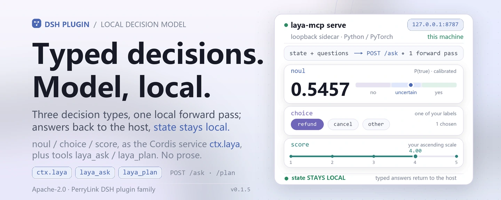
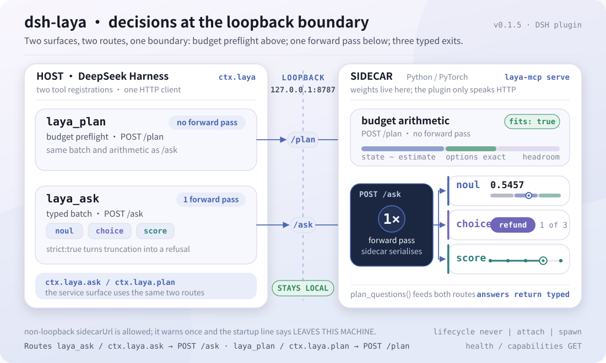
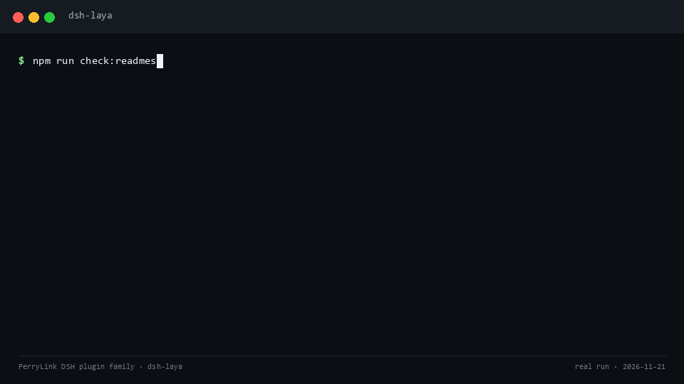

<div align="center">

<picture>
  <source media="(prefers-color-scheme: dark)" srcset="docs/assets/dsh-laya-hero-en-dark.webp">
  
</picture>

# dsh-laya

**Transforme sim/não, qual e quanto em uma única passagem local — as probabilidades voltam ao host e o estado não sai desta máquina.**

As decisões tipadas do Laya (`noul`, `choice`, `score`) chegam ao DeepSeek Harness como um serviço Cordis de primeira classe, `ctx.laya`, e duas ferramentas visíveis para o modelo, `laya_ask` e `laya_plan`: ele não escreve prosa, apenas rótulos, probabilidades calibradas e posições em uma escala.

Última verificação: DeepSeek Harness `dsh-v0.2.3-alpha.1` (2026-11-22).

[Instalar](#instalação-em-três-passos) · [Configuração](#configuração) · [FAQ](#faq) · [简体中文](README.md) · [English](README.en.md) · [Español](README.es.md) · [Português](README.pt.md) · [हिन्दी](README.hi.md)

[](LICENSE)
[](#compatibilidade)
[](https://www.npmjs.com/package/dsh-laya)
[](https://github.com/PerryLink/dsh-laya/actions/workflows/ci.yml)
[](#compatibilidade)

[](https://github.com/PerryLink/dsh-laya/stargazers)
[](https://www.npmjs.com/package/dsh-laya)
[](https://dshfind.com/plugins/PerryLink/dsh-laya?ref=badge)

```sh
dsh plugin --profile <profile> add dsh-laya
```

</div>

<sub>Plugin da comunidade, sem afiliação com a DeepSeek. Repositório canônico: <https://github.com/PerryLink/dsh-laya>.</sub>

## O que é

Laya é um modelo que só responde a perguntas tipadas: `noul` devolve a probabilidade de verdadeiro, `choice` escolhe um dos rótulos que você declarar e `score` posiciona o estado em uma escala ordenada que você define. O `dsh-laya` não contém pesos: Laya é PyTorch, então os pesos ficam no sidecar de Python que você inicia com `laya-mcp serve`, e este plugin é apenas o cliente HTTP dele por loopback.

Ele contribui com duas coisas para o harness: o serviço `ctx.laya` (`ask`, `plan`, `health`, `capabilities`, `sidecarUrl`, `loopback`) e duas ferramentas visíveis para o modelo, `laya_ask` e `laya_plan`. Assim, código do host e outros plugins podem pedir um julgamento sem uma ida e volta ao modelo, e o modelo pode verificar se um lote de perguntas cabe antes de gastar uma passagem.

O endpoint padrão é `http://127.0.0.1:8787`: o estado não sai desta máquina. Apontar `sidecarUrl` para outro lugar é permitido, mas a linha de inicialização nomeia o destino — esse é o momento em que a história de privacidade muda.

<div align="center">

<picture>
  <source media="(prefers-color-scheme: dark)" srcset="docs/assets/dsh-laya-flow-v5-dark.svg">
  
</picture>



*Repetição animada de uma execução real deste repositório (2026-11-21).*

</div>

## Instalação em três passos

Duas peças, porque Laya é PyTorch e não cabe dentro de um plugin de Node.

1. **Inicie o sidecar** (a metade que de fato contém o modelo):

   ```sh
   pip install "laya-mcp[mcp]"
   laya-mcp serve                      # carrega uma vez, escuta em 127.0.0.1:8787
   ```

2. **Instale este plugin**:

   ```sh
   dsh plugin --profile <profile> add dsh-laya
   ```

   Depois confirme que a linha está `active`, e não `failed`.

3. **Verifique se o sidecar responde e leia a linha de inicialização**:

   ```sh
   curl -s http://127.0.0.1:8787/health
   ```

   ```text
   [dsh-laya] sidecar=http://127.0.0.1:8787 (this machine only) · lifecycle=never
   [dsh-laya] ready · tools: laya_ask laya_plan · sidecar=http://127.0.0.1:8787 · state STAYS LOCAL
   ```

   Se a linha de inicialização termina em `STAYS LOCAL` ou em `LEAVES THIS MACHINE`, essa é a resposta sobre para onde vai o estado.

   *Observed from `index.js:461-464; index.js:609-612`*

**Desinstalar**: `dsh plugin --profile <profile> remove dsh-laya` (ou apague a linha do patch do perfil).

> Este plugin não inclui modelo nem executa inferência própria: `laya_plan` não dispara passagem, mas continua sendo uma chamada HTTP ao sidecar. Sem sidecar, as duas ferramentas falham, como explicado nas perguntas frequentes.

## Capacidades principais

O `dsh-laya` liga o julgamento do Laya ao lado do host em vez de embrulhar mais um prompt:

- **Um serviço, `ctx.laya`** — código do host e outros plugins podem perguntar diretamente: `const laya = ctx.get('laya'); const result = await laya.ask({ state, questions })`.
- **Duas ferramentas** — `laya_ask` trata um lote de perguntas tipadas; `laya_plan` confere o orçamento de tokens antes de gastar uma passagem.
- **Três primitivas** — `noul` (sim/não, com faixa `no` / `uncertain` / `yes`), `choice` (um rótulo entre os que você declarar) e `score` (uma posição na escala ordenada que você declarar).
- **Pré-voo de orçamento** — `POST /plan` compartilha a mesma aritmética de `POST /ask` e não executa passagem; os números das opções são exatos e o do estado é uma estimativa por caracteres marcada `"exact": false`.
- **Falhas com significado** — inalcançável é `sidecar_unreachable`, lento demais é `sidecar_timeout`; uma recusa calculada pelo próprio sidecar (como `state_truncated`) é repassada com seu `code` e seu `hint`.
- **Ciclo de vida do sidecar** — `never` / `attach` / `spawn`; um sidecar que já responde é anexado e nunca tocado, e o que este plugin iniciou é encerrado ao desmontar.
- **Seguro para concorrência** — as duas ferramentas declaram `isConcurrencySafe`, então julgamentos independentes entram no pool paralelo do host; o sidecar serializa as passagens por conta própria.

```text
state + questions ──laya_ask──▶ POST /ask  ──▶ laya-mcp serve ──▶ noul / choice / score
state + questions ──laya_plan─▶ POST /plan ──▶ aritmética de orçamento (sem passagem)
```

### Superfície de serviço e ferramentas

| Superfície | Executa passagem | Notas |
|---|---|---|
| `ctx.laya.ask` | sim | Passthrough para `POST /ask`; devolve a carga bruta do sidecar |
| `ctx.laya.plan` | não | Passthrough para `POST /plan`, a mesma aritmética de `ask` |
| `ctx.laya.health` | não | `GET /health`: checkpoints, número de chamadas, `degraded` |
| `ctx.laya.capabilities` | não | `GET /capabilities` |
| `ctx.laya.sidecarUrl` / `loopback` | não | O endpoint atual e se o estado fica nesta máquina — um fato, não uma política |
| `laya_ask` | sim | Um lote de perguntas tipadas; `strict: true` transforma truncamento em recusa |
| `laya_plan` | não | Pré-voo do orçamento; informa o que cabe sem produzir resposta |

### Exemplo de chamada

A forma mínima de pergunta do `SKILL.md` — é isto que vai em `questions.<id>` do `laya_ask`, com a evidência em `state`:

```json
{
  "type": "noul",
  "instructions": "Does the user threaten to cancel?",
  "boundary": {
    "true": "an explicit threat to cancel or not renew",
    "false": "no threat, however annoyed the tone"
  }
}
```

Um `choice` recebe `criteria` como mapa de rótulo para descrição; um `score` recebe `criteria` como array crescente de descrições de nível, pelo menos dois e todos descritos. Um `noul` pode omitir `criteria` e, quando fornecido, deve ser `{"true": …, "false": …}`. O cartão da ferramenta mostra um `noul` como `<id>=<probabilidade> (<faixa>)`, um `choice` como o rótulo e um `score` como o valor da escala.

*Observed from `index.js:256-273; index.js:341-365`*

## Dados medidos

| Medição | Valor |
|---|---|
| Contrato do sidecar, ponta a ponta (RTX 5060) | 9,8 s de carga; 411 ms para três perguntas em CUDA |
| `noul` sem `boundary` | 40/40 itens respondidos como falso (inglês e chinês iguais): exatamente o acaso |
| `noul` com `boundary` | Os mesmos 40 itens: 1,000 e 0,975 |
| Um exemplo real de calibração | 0,5457 com a faixa `uncertain` |

São medições que já aconteceram na camada de integração e nos documentos da skill, não um benchmark que este repositório rodou de novo. Aqui não há `benchmark/RESULTS.md`, então nenhum gráfico de dados medidos é desenhado; os números de precisão do upstream estão em Limitações conhecidas.

## Configuração

Todo ajuste é um campo de `Config`, documentado chave a chave em `cordis.patch.yml`. Uma sobrescrita por id substitui a linha inteira — repita todas as chaves de que precisa.

Chaves mais usadas:

| Chave | Padrão | Significado |
|---|---|---|
| `sidecarUrl` | `'http://127.0.0.1:8787'` | Endereço do sidecar. Loopback = o estado não sai desta máquina; apontar para outro lugar muda a história de privacidade e avisa uma vez na inicialização, nomeando o destino |
| `lifecycle` | `never` | O que fazer quando nada responde em `sidecarUrl`: `never` / `attach` / `spawn` (veja abaixo) |
| `spawnCommand` | `null` | O comando a executar com `lifecycle: spawn`, estilo argv. Sem padrão: este plugin não adivinha um interpretador |
| `requestTimeoutMs` | `120000` | Timeout por requisição. A inferência aquecida leva 30–500 ms, mas a primeira chamada após uma inicialização fria pode pagar o carregamento do modelo |
| `logLevel` | `info` | `silent` / `warn` / `info` / `debug`. `debug` registra linha a linha o stdout / stderr do sidecar iniciado |

`lifecycle` decide o que acontece quando nada responde em `sidecarUrl`:

| | |
|---|---|
| `never` | Não inicia nada; assume que outra coisa gerencia o sidecar. O padrão. |
| `attach` | Também consulta `/health` uma vez ao carregar e registra o que encontrou — útil quando o harness e o sidecar disputam a inicialização. |
| `spawn` | Também executa `spawnCommand` se nada responder, e espera ele subir. |

`spawn` existe porque a alternativa era pior. O plugin continua sem instalar e sem baixar nada — uma ferramenta que rodasse `pip install` e depois trouxesse um checkpoint de 650 MB pelas suas costas seria hostil, e isso não mudou. Mas *lançar um sidecar que você já instalou* é outro ato; sem ele, cada sessão começava iniciando um processo de Python à mão no terminal, e voltava a falhar sempre que esse processo sumia.

Duas regras o tornam seguro para deixar ligado:

* Um sidecar que já responde é **anexado e nunca tocado**, então duas sessões do harness não colocam dois modelos na mesma porta.
* Um sidecar iniciado por este plugin é **encerrado quando o plugin é desmontado**; um que ele não iniciou fica exatamente como foi encontrado.

A separação também rende o modelo aquecido: a construção fria do Laya custa de segundos a dezenas de segundos, e seu roteador preguiçoso padrão reconstrói um checkpoint a cada troca de idioma. `laya-mcp serve` paga isso uma vez.

No Windows um script de console é um shim `.cmd`, que aqui é resolvido via `cmd.exe /c`; apontar para `python -m laya_mcp` evita isso por completo.

<details>
<summary>Tabela completa de configuração (6 chaves)</summary>

| Chave | Padrão | Significado |
|---|---|---|
| `sidecarUrl` | `'http://127.0.0.1:8787'` | Endereço do sidecar; precisa ser uma URL http(s). Loopback por padrão — o sidecar não tem autenticação e não deve ser exposto |
| `requestTimeoutMs` | `120000` | Timeout por requisição em milissegundos. A primeira chamada após inicialização fria pode pagar o carregamento do modelo, por isso é generoso de propósito |
| `lifecycle` | `never` | `never` assume que outra coisa gerencia o sidecar; `attach` consulta `/health` uma vez ao carregar e registra; `spawn` executa `spawnCommand` quando nada responde |
| `spawnCommand` | `null` | O comando para `spawn`, estilo argv, por exemplo `['laya-mcp', 'serve']` ou `['python', '-m', 'laya_mcp', 'serve', '--model', 'english']`. Validado ao carregar, então um erro de digitação falha na inicialização nomeando o campo |
| `spawnTimeoutMs` | `120000` | Quanto esperar para o sidecar iniciado responder `/health`, em milissegundos. Um timeout é reportado, não fatal: as ferramentas funcionam assim que o sidecar responder |
| `logLevel` | `info` | `silent` / `warn` / `info` / `debug` |

Valores inválidos falham em voz alta ao carregar: `sidecarUrl` precisa ser não vazia e http(s); os dois timeouts precisam ser positivos; `lifecycle` precisa ser um dos três; `spawnCommand` precisa ser um array não vazio de strings não vazias; `logLevel` precisa ser um dos quatro.

</details>

Exemplo de sobrescrita no patch do perfil:

```yaml
- insert:
    - id: laya
      name: 'dsh-laya'
      config:
        sidecarUrl: 'http://127.0.0.1:8787'
        requestTimeoutMs: 120000
        lifecycle: never      # 'attach' registra uma checagem de alcance,
                              # 'spawn' inicia o sidecar por conta própria
        spawnCommand: null    # obrigatório com 'spawn', p. ex. ['laya-mcp', 'serve']
        spawnTimeoutMs: 120000
        logLevel: info
```

## FAQ

<details>
<summary>Para onde o estado realmente vai? Pode chegar à nuvem?</summary>

Só para `sidecarUrl`. O padrão é `127.0.0.1:8787`, esta máquina, e então a linha de inicialização diz `state STAYS LOCAL`. Apontar `sidecarUrl` para um host não loopback é permitido, mas avisa uma vez na inicialização e nomeia o destino — esse é o momento em que a história de privacidade muda. O plugin não instala, não baixa, não envia telemetria e não guarda o estado em lugar nenhum.

</details>

<details>
<summary>E se o sidecar estiver fora do ar ou morrer? Falha em silêncio?</summary>

Nada é silencioso. Um sidecar inalcançável faz as ferramentas retornarem `sidecar_unreachable`, um timeout retorna `sidecar_timeout`, e ambas dizem para iniciar `laya-mcp serve`; as ferramentas continuam registradas e se recuperam assim que algo responder. `lifecycle: attach` consulta `/health` uma vez ao carregar e registra o resultado; `lifecycle: spawn` executa `spawnCommand` quando nada responde, e um timeout de inicialização avisa sem ser fatal; um sidecar iniciado que sai registra um aviso visível.

</details>

<details>
<summary>Disputa nomes de ferramentas, chaves de serviço ou slots com outros plugins?</summary>

Não. Os nomes de ferramentas têm espaço de nomes (`laya_ask`, `laya_plan`), ele publica exatamente uma chave de serviço, `laya`, o `inject` só espera por `tools`, e não registra comandos, slots de cliente nem prefixos `webServer`, nem altera globais. O argumento ponto a ponto está em «Interoperabilidade com outros plugins DSH».

</details>

<details>
<summary>Por que preciso instalar um sidecar de Python à parte? Não dá para incluir?</summary>

Porque Laya é PyTorch e os pesos são um checkpoint de centenas de megabytes que não cabe dentro de um plugin de Node. Um plugin que rodasse `pip install` escondido e baixasse pesos seria hostil por mais conveniente que fosse, então este atua apenas como cliente; até o `lifecycle: spawn` lança um comando que você **já instalou**, e `spawnCommand` não tem padrão.

</details>

<details>
<summary>Como ler a saída? Com o que se preocupar em `confidence` e no truncamento?</summary>

`confidence` não é acurácia, mas uma estatística de concentração sobre as opções: é baixa mesmo quando a opção principal está certa, e alta em uma resposta confiante e errada. Por isso um `noul` também carrega uma faixa `no` / `uncertain` / `yes` — 0,5457 com `uncertain` é um exemplo real desta stack. O truncamento é o oposto: um estado grande demais é cortado **pelo final** sem aviso, e a resposta é sobre o prefixo sobrevivente; leia `truncated`, `budget_summary` e `warnings`, ou chame `laya_plan` antes.

</details>

## Limites de segurança

- **Nada é instalado nem baixado.** Este plugin não contém pesos nem executa `pip install`; `lifecycle: spawn` só lança um comando que o operador nomeia explicitamente, e `spawnCommand` não tem padrão, então nunca adivinha um interpretador.
- **Destino visível.** O estado é enviado apenas para `sidecarUrl`; um endereço não loopback avisa uma vez na inicialização e nomeia o destino, e a linha de inicialização sempre declara `STAYS LOCAL` ou `LEAVES THIS MACHINE`.
- **O sidecar não tem autenticação.** Ele escuta em `127.0.0.1:8787` por padrão; não o exponha à internet nem aponte `sidecarUrl` para um host compartilhado.
- **Sem preempção.** Um sidecar que já responde é anexado e nunca tocado, então duas sessões do harness não colocam dois modelos na mesma porta; este plugin só encerra o sidecar que iniciou e deixa qualquer outro processo exatamente como estava.
- **Configuração errada falha ao carregar.** `sidecarUrl` inválida, timeout não positivo, `lifecycle` desconhecido, `spawnCommand` malformado ou `logLevel` desconhecido falham em voz alta na inicialização nomeando o campo, em vez de esperar a primeira chamada.
- **Registros são efeitos.** O serviço, as ferramentas e o ciclo de vida do sidecar dependem de efeitos do Cordis: parar ou recarregar a quente os remove, e o sidecar iniciado por este plugin para junto.

## Permissões e dados

- **Permissões**: `dsh.capabilities` do `package.json` declara apenas `network:egress`. O plugin não escreve arquivos, não guarda cache e não armazena credenciais; sua única chamada ao sistema de arquivos resolve `spawnCommand` no `PATH` (`existsSync` em `sidecar.js`).
- **Dados**: o corpo da requisição (`state` + `questions`) é repassado como está para `sidecarUrl`, loopback por padrão; o plugin não grava em disco, não faz cache e não tem telemetria.
- **Logs**: apenas a linha de inicialização, resumos de saúde e erros; `logLevel` controla o detalhe e `debug` registra linha a linha o stdout / stderr do sidecar para manter um traceback de Python visível.
- **Sessão**: `answers`, `truncated`, `budget_summary` e `warnings` da ferramenta são exatamente o que o modelo vê; o plugin não acrescenta nada ao log de sessão.

## Limitações conhecidas

- **A precisão do upstream é o teto.** Repetido das próprias medições do upstream, porque uma integração que insinue outra coisa está mentindo para você: os checkpoints base estão **perto do acaso em zero-shot** em decisões tipadas (0,362 em inglês contra uma linha de base de classe majoritária de 0,461); `score` é a primitiva mais fraca (35% contra 70% do Jev em medição independente); o erro bruto de calibração é 0,466 antes do ajuste de temperatura; e a precisão cai acima de cerca de 20 opções. A calibração torna uma probabilidade honesta. Não torna um modelo correto.
- **Truncamento silencioso.** Um estado grande demais é cortado **pelo final**, a resposta passa a ser sobre o prefixo sobrevivente e a própria saída do Laya não admite isso. A resposta reporta em `truncated` e o `laya_plan` avisa antes de perguntar; passe `strict: true` para recusar em vez disso — verificado contra o sidecar ao vivo, que retorna HTTP 400 com `state_truncated` e uma dica nomeando `max_len`.
- **`confidence` não é acurácia.** É uma estatística de concentração: baixa quando a probabilidade se espalha entre opções mesmo com a principal correta, e alta em uma resposta confiante e errada. Um `noul` também carrega uma faixa `no` / `uncertain` / `yes`, porque uma probabilidade calibrada não é uma decisão — um exemplo real medido nesta stack retornou 0,5457 com a faixa `uncertain`.
- **Uma degradação silenciosa para CPU é reportada.** Se o Laya cai para CPU após um erro de dispositivo, nunca volta ao acelerador e nada na saída dele admite isso. A superfície de saúde carrega `degraded` e o cartão da ferramenta acrescenta `CPU (degraded)`.
- **Cobertura de idiomas limitada.** O detector cobre apenas en / fr / de / es / pt / it / nl; qualquer outro idioma em escrita latina é roteado em silêncio para o checkpoint inglês, que então responde com confiança e errado. Passe `lang` (por exemplo `"de"`) ao `laya_ask` para fixar o idioma.
- **O sidecar é por sua conta.** Este plugin não inclui modelo: sem `laya-mcp serve` rodando, as ferramentas retornam `sidecar_unreachable` (ou `sidecar_timeout` se estiver lento demais).
- **Estado (em desenvolvimento).** O plugin monta e ativa no harness, e o contrato do sidecar que ele fala foi verificado ponta a ponta em uma RTX 5060 (9,8 s de carga, 411 ms para três perguntas em CUDA); ainda não foi exercitado por um turno real de modelo em CI.

## Interoperabilidade com outros plugins DSH

Verificado contra a superfície de registro em `index.js` e `cordis.patch.yml`. Este plugin não interfere em outros:

- **Um único serviço consumido.** `inject = ['tools']`, e só isso: o Cordis faz o plugin esperar por cada chave de `inject`, então listar um serviço que a maioria dos perfis não compõe (como `skills`) deixaria o plugin `pending` para sempre.
- **Ferramentas com espaço de nomes.** `laya_ask` e `laya_plan`; nenhum nome nu de ferramenta embutida ou de outro plugin é registrado.
- **Uma única chave de serviço publicada.** `laya`; ele não oferece mais nada, então não pode colidir em chave de serviço.
- **Sem comandos, slots ou rotas HTTP.** Não registra comando DSH, chave de slot de cliente nem prefixo `webServer`.
- **Sem colisão de camada de patch.** O patch do bundle apenas faz `insert` da própria linha; nunca sobrescreve o `config` de uma linha embutida.
- **Sem mutação global.** Não altera protótipos, não reescreve `process.env` nem substitui o dispatcher global de fetch.
- **Sem listeners de eventos compartilhados.** Nunca chama `ctx.on(...)`, então não disputa eventos sensíveis à ordem e não pode curto-circuitar uma cadeia.
- **Declaração de concorrência.** As duas ferramentas declaram `isConcurrencySafe`, então julgamentos independentes entram no pool paralelo do host; o sidecar serializa as passagens por conta própria.

## Compatibilidade

| Dimensão | Estado |
|---|---|
| Harness | Verificado contra `dsh-v0.1.7-alpha.1` (a versão do host que esta build mira); exige `>=0.1.7-alpha.1 <0.3.0` (`engines.dsh` no `package.json`) |
| Node | `^22.19.0 \|\| >=24.0.0` (a CI roda Node 22 e 24) |
| Plataformas | Onde o DSH rodar, mais um sidecar local de Python (PyTorch); verificado em uma RTX 5060 com CUDA, e a queda para CPU é reportada como `degraded` |
| Modelo | Um checkpoint do Laya (`noul` / `choice` / `score`); não é um modelo generativo e não escreve texto, código ou comandos |
| CI | `ubuntu-latest` e `windows-latest` × Node 22 / 24: `npm test` + `npm run check:readmes` |

## Ecossistema e qualidade

- [Pacote npm](https://www.npmjs.com/package/dsh-laya) (atualmente 0.1.7)
- [Página no dshfind](https://dshfind.com/plugins/PerryLink/dsh-laya) (instalações e ranking; mesma fonte do selo)
- [Upstream do Laya](https://github.com/NandhaKishorM/laya) (os pesos do modelo e o sidecar `laya-mcp`; Apache-2.0)
- **CI**: [`.github/workflows/ci.yml`](.github/workflows/ci.yml) executa `npm test` e `npm run check:readmes` em dois sistemas × duas versões de Node, deliberadamente sem etapa de `npm install`: os testes cobrem apenas a superfície pura (`plan.js`, `sidecar.js`) e não precisam de um harness montado.

## Desenvolvimento

```sh
npm test                 # node --test (a superfície pura de plan.js / sidecar.js)
npm run check:readmes    # sincronia dos READMEs em cinco idiomas: seções / comando / chaves
npm pack                 # o tarball publicado
```

Não há etapa de build: ESM puro; `index.js`, `plan.js` e `sidecar.js` são os artefatos publicados; `SKILL.md` e `cordis.patch.yml` também viajam (veja `files` no `package.json`).

As imagens do README são geradas por programa com [`scripts/gen-readme-assets.py`](scripts/gen-readme-assets.py) (Python + Pillow, com sondagem de fontes CJK) e podem ser executadas de novo: `python scripts/gen-readme-assets.py`.

Estrutura:

```text
index.js            plugin Cordis: validação de Config, serviço ctx.laya, ferramentas laya_ask / laya_plan
plan.js             a superfície pura do pré-voo (schema de saída, formatação, resumo)
sidecar.js          resolução e ciclo de vida do spawn (PATH, cmd.exe /c, encerramento do processo)
SKILL.md            as instruções do Laya para o agente (viajam no pacote)
cordis.patch.yml    a linha do bundle; cada chave de Config comentada em linha
test/               node --test (plan / sidecar)
scripts/            portões mecânicos: check-readme-sync.mjs, gen-readme-assets.py
```

Topics: `dsh-plugin`, `deepseek-harness`, `cordis`, `laya`, `decision-model`, `system-one`, `typed-decisions`

## Família e agradecimentos

Este projeto faz parte da família de plugins de DeepSeek Harness da [PerryLink](https://github.com/PerryLink) (todos Apache-2.0). Se ele for útil, **uma estrela ajuda a próxima pessoa a encontrá-lo** — nada fica bloqueado por trás disso.

- [@PerryLink](https://github.com/PerryLink) — criador e mantenedor: o serviço `ctx.laya`, as ferramentas `laya_ask` / `laya_plan`, o ciclo de vida do sidecar (`never` / `attach` / `spawn`) e a documentação em cinco idiomas.
- [Convai Innovations / Laya](https://github.com/NandhaKishorM/laya) — autores do modelo upstream e do sidecar `laya-mcp`; este plugin é uma integração independente, não um componente oficial daquele projeto.

<details>
<summary>Mostrar todos os plugins</summary>

| Plugin | Status |
|---|---|
| **[dsh-auto-review](https://github.com/PerryLink/dsh-auto-review)** |  |
| **[dsh-autotier](https://github.com/PerryLink/dsh-autotier)** | 🧊 CONGELADO — ver o README do repo |
| **[dsh-background-agents](https://github.com/PerryLink/dsh-background-agents)** | 🚫 APOSENTADO (repo arquivado) |
| **[dsh-budget](https://github.com/PerryLink/dsh-budget)** | 🧊 CONGELADO — ver o README do repo |
| **[dsh-catalog](https://github.com/PerryLink/dsh-catalog)** |  |
| **[dsh-cert-mcp](https://github.com/PerryLink/dsh-cert-mcp)** | 🧊 CONGELADO — ver o README do repo |
| **[dsh-checkpoint-rewind](https://github.com/PerryLink/dsh-checkpoint-rewind)** |  |
| **[dsh-claude-move](https://github.com/PerryLink/dsh-claude-move)** | 🧊 CONGELADO — ver o README do repo |
| **[dsh-click](https://github.com/PerryLink/dsh-click)** |  |
| **[dsh-composer-history](https://github.com/PerryLink/dsh-composer-history)** |  |
| **[dsh-data-quality](https://github.com/PerryLink/dsh-data-quality)** | 🧊 CONGELADO — ver o README do repo |
| **[dsh-defend](https://github.com/PerryLink/dsh-defend)** | 🧊 CONGELADO — ver o README do repo |
| **[dsh-doublecheck](https://github.com/PerryLink/dsh-doublecheck)** |  |
| **[dsh-draw](https://github.com/PerryLink/dsh-draw)** | 🧊 CONGELADO — ver o README do repo |
| **[dsh-fast](https://github.com/PerryLink/dsh-fast)** |  |
| **[dsh-fund-research](https://github.com/PerryLink/dsh-fund-research)** |  |
| **[dsh-github](https://github.com/PerryLink/dsh-github)** |  |
| **[dsh-industry-research](https://github.com/PerryLink/dsh-industry-research)** |  |
| **[dsh-laya](https://github.com/PerryLink/dsh-laya)** |  |
| **[dsh-library](https://github.com/PerryLink/dsh-library)** |  |
| **[dsh-local-ai](https://github.com/PerryLink/dsh-local-ai)** |  |
| **[dsh-lsp-actions](https://github.com/PerryLink/dsh-lsp-actions)** |  |
| **[dsh-mask](https://github.com/PerryLink/dsh-mask)** |  |
| **[dsh-mcp-panel](https://github.com/PerryLink/dsh-mcp-panel)** |  |
| **[dsh-memento](https://github.com/PerryLink/dsh-memento)** | 🧊 CONGELADO — ver o README do repo |
| **[dsh-observe](https://github.com/PerryLink/dsh-observe)** |  |
| **[dsh-output-styles](https://github.com/PerryLink/dsh-output-styles)** |  |
| **[dsh-permission-rules](https://github.com/PerryLink/dsh-permission-rules)** |  |
| **[dsh-plugin-certification](https://github.com/PerryLink/dsh-plugin-certification)** | 🚫 APOSENTADO (repo arquivado) |
| **[dsh-plugin-doctor](https://github.com/PerryLink/dsh-plugin-doctor)** | 🚫 APOSENTADO (repo arquivado) |
| **[dsh-plugin-guide](https://github.com/PerryLink/dsh-plugin-guide)** |  |
| **[dsh-plugin-kit](https://github.com/PerryLink/dsh-plugin-kit)** | 🚫 APOSENTADO (repo arquivado) |
| **[dsh-plugin-upgrade](https://github.com/PerryLink/dsh-plugin-upgrade)** | 🚫 APOSENTADO (repo arquivado) |
| **[dsh-plugin-upgrade-015](https://github.com/PerryLink/dsh-plugin-upgrade-015)** | 🚫 APOSENTADO (repo arquivado) |
| **[dsh-reach](https://github.com/PerryLink/dsh-reach)** | 🧊 CONGELADO — ver o README do repo |
| **[dsh-research-report](https://github.com/PerryLink/dsh-research-report)** |  |
| **[dsh-score](https://github.com/PerryLink/dsh-score)** | 🧊 CONGELADO — ver o README do repo |
| **[dsh-session-pin](https://github.com/PerryLink/dsh-session-pin)** | 🚫 APOSENTADO (repo arquivado) |
| **[dsh-session-sync](https://github.com/PerryLink/dsh-session-sync)** |  |
| **[dsh-skill-pack-security](https://github.com/PerryLink/dsh-skill-pack-security)** |  |
| **[dsh-talk](https://github.com/PerryLink/dsh-talk)** |  |
| **[dsh-team-rooms](https://github.com/PerryLink/dsh-team-rooms)** | 🚫 APOSENTADO (repo arquivado) |
| **[dsh-test-drive](https://github.com/PerryLink/dsh-test-drive)** |  |
| **[dsh-ticktick](https://github.com/PerryLink/dsh-ticktick)** | 🚫 APOSENTADO (repo arquivado) |
| **[dsh-translate](https://github.com/PerryLink/dsh-translate)** |  |

</details>

## Licença

[LICENSE](LICENSE) (Apache License 2.0) © 2026 dsh-laya contributors. Laya é Apache-2.0 da Convai Innovations; esta é uma integração independente e não é afiliada nem endossada por aquele projeto.

<p align="center"><sub>Apache-2.0 · Plugin da comunidade, sem afiliação com a DeepSeek.</sub></p>
